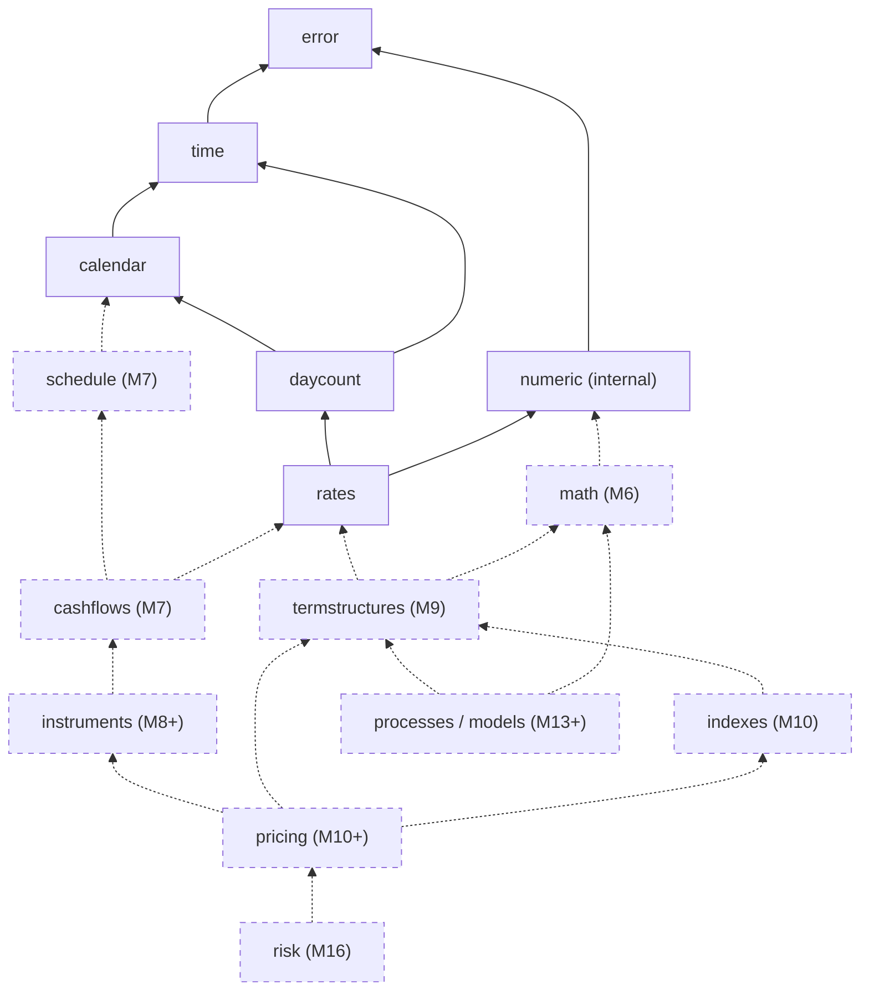

# Architecture

| Field | Value |
|---|---|
| Milestone | M0 |
| Document status | **Proposed**: every decision here awaits owner approval through the ADRs it cites |
| Related | [DOMAIN_MODEL](DOMAIN_MODEL.md), [API_DESIGN_PRINCIPLES](API_DESIGN_PRINCIPLES.md), [ADR index](adr/README.md), [QUANTLIB_REFERENCE §6](QUANTLIB_REFERENCE.md#6-architecture-analysis-what-transfers-to-rust) |

SabiQuant is meant to be a long-lived financial domain library. The
architecture aims for the **simplest structure that meets the known
requirements** and stays extensible as the domains grow. No code exists. Names
below are conceptual.

---

## 1. Architectural drivers

| Driver | Source | Architectural consequence |
|---|---|---|
| Financial correctness | C-05, NFR-01 | Specification-first; pure functions; convention parameters held in types |
| Standard library only | C-02, ADR-0002 | No dependency graph to manage; in-house numerics; std-parsable fixtures |
| Determinism | NFR-03 | No global state; no clock; no hidden caches; deterministic ordering |
| Thread safety | NFR-05 | Immutable values; all public types can be sent and shared between threads |
| No panics on invalid input | NFR-02 | `Result` everywhere; checked integer arithmetic |
| API stability | NFR-10, ADR-0009 | Small public surface; private fields; non-exhaustive enums |
| Maintainability by a solo maintainer | A-01 | One crate; clear module boundaries; few abstractions |
| Long-term growth to QuantLib-scale domains | VISION | Acyclic domain layering that leaves room for new modules |

## 2. Owner constraints that shape the architecture

Native Rust ([ADR-0001](adr/ADR-0001-native-rust.md)), standard library only
([ADR-0002](adr/ADR-0002-standard-library-only.md)), independent
implementation with QuantLib as reference only
([ADR-0003](adr/ADR-0003-quantlib-compatibility.md)), and correctness before
performance.

## 3. Alternatives evaluated

### 3.1 Single crate or multi-crate workspace ([ADR-0004](adr/ADR-0004-project-structure.md))

| Criterion | Single crate with modules | Workspace with several crates |
|---|---|---|
| Fits the initial scope (four foundational modules) | Yes | More structure than needed |
| Boundary enforcement | Module privacy (`pub(crate)`); reviewed dependency rules | Enforced by the compiler between crates |
| Versioning and releases | One version, one changelog | One version per crate, or lockstep; coordination cost |
| Std-only constraint | No effect | No effect (internal crates are not third-party) |
| Refactoring across domains | Cheap | Costly (API between crates) |
| Compile time | Fine at foundation size | Better parallelism at large size |
| Optional data-heavy parts (calendars) | Cargo features | Separate crates |

**Proposal: one library crate, `sabiquant`** (the name was unclaimed on
crates.io on 2026-10-10, and has not been reserved). Reconsideration
triggers: one component needs an independent release cadence (for example
holiday-data updates); compile times become a measured problem; or a
component must be optional for size reasons and Cargo features are not
enough.

### 3.2 Domain modules or technical layers

Modules are organized **by financial domain** (time, calendar, day count,
rates, and later schedules, cash flows, curves). They are not organized by
technical layer (models, services, utilities). The one exception is a `math`
module for numerical algorithms that several domains share (from M6). Domain
modules match the ubiquitous language and how QuantLib users look for things,
and they let each milestone add a module rather than editing every layer.

### 3.3 Public and internal API

- The public surface is the smallest that meets the requirements. Helpers are
  internal to the crate.
- Fields of invariant-carrying types are private. Construction goes through
  validating constructors.
- Each domain module exposes its own types. A crate-level convenience
  re-export or "prelude" is **deferred** until after the M5 API review, to
  avoid freezing namespace decisions early.
- Test-only support code (pseudo-random generators, ULP comparison, fixture
  reading) is not public API.

### 3.4 Shared or domain-specific types

Shared code is limited to the error conventions and the numeric validation
policy. Everything else lives in its domain module. This avoids a "common"
module that grows without limit and pulls everything into one coupling point.

### 3.5 Traits or enums

| Situation | Choice | Reason |
|---|---|---|
| Closed, market-defined sets (conventions, frequencies, compounding, units) | Enum | Exhaustive, `Copy`, no allocation, stable identifiers |
| Parameterized conventions (30E/360 ISDA, Business/252) | Enum variants carrying the parameters | Required inputs are enforced |
| User-extensible behavior (custom calendars) | Data-driven values first; a trait only when a concrete need is shown | A trait is a permanent API commitment |
| Future families of algorithms (solvers, interpolators, pricing methods) | Traits with static dispatch by default | Polymorphism without runtime cost; decided per milestone |

### 3.6 Static or dynamic dispatch

Static dispatch (enum `match`, generics) is the default. Dynamic dispatch
(trait objects) is used only at explicit extension points where heterogeneous
collections are needed, and always with thread-safety bounds. Foundational
code has no performance reason to prefer either. The choice is about API
clarity.

### 3.7 Error handling

Summary of [ADR-0007](adr/ADR-0007-error-handling.md): `Result` for every
fallible operation; one non-exhaustive error enum per domain plus a
crate-level error that wraps them; structured context; no panics on invalid
input; no panicking arithmetic operators in the first release.

### 3.8 Data ownership

- Small values (dates, periods, enumerations, quotes without calendars) are
  `Copy`.
- Values holding variable-size data (calendars with holiday sets, conventions
  holding calendars) are `Clone`. Large immutable data is shared through
  reference counting that is safe across threads, so clones are cheap and
  never alias mutable state.
- Public types never use reference counting or interior mutability that is
  only safe on a single thread.
- Functions borrow inputs and return owned values. Public types have no
  lifetime parameters in H1, which keeps the API simple.

### 3.9 Immutability

All public values are immutable. "Modifying" a value (for example adding a
holiday) returns a new value. This rules out QuantLib-style shared mutation
(B-07) and makes values safe to cache and to share.

### 3.10 Thread safety and concurrency

All public types can be sent and shared between threads (NFR-05). There is no
interior mutability, no global cache, and no thread-local state. The library
starts no threads in H1. When parallel algorithms arrive (Monte Carlo, M13),
they will use std's scoped threads with deterministic work partitioning and
reduction order, so results do not depend on scheduling (NFR-03).

### 3.11 Financial state management ([ADR-0011](adr/ADR-0011-explicit-state.md))

There is no global evaluation date, settings singleton, fixing store, or
shared mutable calendar registry. The valuation date and market data are
explicit inputs. From M9, an immutable **valuation context** (valuation date,
curves, fixings, quotes) is passed explicitly to pricing functions. Scenarios
are new contexts derived from old ones. This trades QuantLib's automatic
recalculation for reproducibility, testability, and freedom from data races.
The cost is recorded as risk [R-07](IMPLEMENTATION_READINESS.md#6-risk-register).

### 3.12 Dependency direction

Dependencies point **down** the domain stack (§5). Lower modules never know
about higher ones, and there are no cycles. New domains are added on top.

### 3.13 Backward compatibility

See [ADR-0009](adr/ADR-0009-api-stability.md): semantic versioning; 0.x until
the foundations are validated; non-exhaustive enums; private fields;
deprecation before removal; and changes to numerical behavior are flagged in
release notes even when the API does not change.

### 3.14 Feature growth

- Each milestone adds a module, or extends one, without changing the modules
  below it except to add capability.
- Cargo features are used only for optional, size-heavy components such as
  large sets of market calendars, and only if size becomes a measured
  problem. There are no default-on optional features in H1.
- No build scripts and no procedural macros (std-only; simplicity).

### 3.15 Cross-platform behavior

The crate is pure Rust on std, with no code specific to an operating system or
architecture. Integer and date logic is identical on every platform.
Floating-point basic operations are IEEE 754 correctly rounded on all
supported targets. Transcendental functions are not guaranteed identical
across platforms ([NUMERICAL_CORRECTNESS §6](NUMERICAL_CORRECTNESS.md#6-determinism-and-cross-platform-reproducibility)).
Supported-platform tiers are decided in [OQ-08](IMPLEMENTATION_READINESS.md#5-decision-register).
Proposed primary tier: x86_64 Linux, aarch64 macOS, x86_64 Windows.

## 4. Proposed crate and module structure

| Module (conceptual) | Responsibility | Milestone | Public? |
|---|---|---|---|
| `error` | Crate-level error and shared error conventions | M1 | Yes |
| `numeric` | Finiteness and domain validation, stable elementary formulations, internal constants | M1 | Internal (crate-private) |
| `time` | Date, Weekday, Month, Period, TimeUnit, Frequency, ISO text | M2 | Yes |
| `calendar` | Calendar values (null, weekends-only, custom, joint, market calendars), business-day conventions, adjustment, advancement, counting, Easter, provenance metadata | M3 | Yes |
| `daycount` | Day-count conventions, day counts, year fractions | M3 | Yes |
| `rates` | Compounding, interest-rate quote, compound and discount factors, implied and equivalent rates, rate-based discounting | M4 | Yes |
| *Future*: `math`, `schedule`, `cashflows`, `termstructures`, `indexes`, `instruments`, `pricing`, `processes`, `models`, `risk` | See [ROADMAP §4](ROADMAP.md#4-future-milestones-provisional) | M6+ | Decided per milestone |

`core` is deliberately **not** used as a module name. Paths that start with
`core` would become ambiguous between the local module and Rust's built-in
`core` crate.

## 5. Module dependency graph

Solid edges are foundational and proposed for M1–M4. Dashed edges are future
and provisional.

## 6. Dependency rules

1. A module may depend only on modules below it in §5. A dependency upwards
   or sideways that is not in the graph needs an ADR update.
2. `error` depends on nothing in the crate. Every module may use it.
3. `numeric` is internal and contains no financial conventions.
4. Calendar data and rules live only in `calendar`. Day-count rules live only
   in `daycount`. Date primitives live only in `time`.
5. No module reads global state, the clock, the environment, or files
   (NFR-07, NFR-13).
6. Code that exists only for tests never becomes public API.

## 7. Numerical architecture

- `f64` throughout H1 ([ADR-0006](adr/ADR-0006-numeric-policy.md)).
- Numerically sensitive formulas (compounding, implied and equivalent rates)
  are implemented once, in internal helpers, with documented stable
  formulations ([NUMERICAL_CORRECTNESS §9](NUMERICAL_CORRECTNESS.md#9-analyses-of-foundational-computations)).
- Integer date and day-count arithmetic is checked. Library correctness never
  depends on build-profile overflow checks, because a library's profile
  settings do not apply to the projects that depend on it.
- No fast-math, no reliance on floating-point contraction, and fused
  multiply-add only where a specification calls for it explicitly.

## 8. State, context, and concurrency architecture

| Concern | H1 design | Future design |
|---|---|---|
| Valuation date | Not needed by H1 operations, which are pure functions of dates | An explicit field of the valuation context (M9) |
| Market data | None in H1 | An immutable valuation context. Scenarios are derived contexts |
| Historical fixings | None in H1 | Explicit fixing history inside the context (M10) |
| Calendar customisation | New calendar values | Same |
| Caching | None | Allowed only inside explicit, owned context objects. Never process-wide. Must not change results |
| Parallelism | None | Scoped threads, deterministic partitioning and reduction |

## 9. Extension points

| Extension need | H1 mechanism | Later |
|---|---|---|
| A market calendar SabiQuant does not provide | Custom calendar (weekends plus holiday dates); joint calendars | A public calendar-rule trait, if justified (ADR) |
| A day-count convention SabiQuant does not provide | Not supported | A trait-based extension, if justified (ADR) |
| New compounding methods | Not supported (closed set) | Add variants (non-exhaustive enum) |
| Solvers, interpolators, pricing methods | — | Traits, designed per milestone |

## 10. Repository layout (future, conceptual)

Nothing below is created in M0. The layout takes effect from M1 if approved.

| Path | Content | Introduced |
|---|---|---|
| `README.md`, `docs/` | Project documentation, ADRs | M0 |
| Package manifest and source tree | The `sabiquant` crate, with modules as in §4 | M1 (after approval) |
| Integration-test directory | Cross-module and differential tests | M1–M2 |
| `validation/fixtures/` | Committed reference fixtures (data only) | M2 |
| `validation/generator/` | External reference-generation tooling, **excluded from the published crate** ([ADR-0008](adr/ADR-0008-validation-strategy.md), OQ-13) | M2 |
| `validation/DISCREPANCIES.md` | Discrepancy log | M2 |
| Benchmark directory | Custom-harness benchmarks | Later (M6+) |
| Licence files, `CHANGELOG.md`, root `CONTRIBUTING.md`, `SECURITY.md` | Governance files | After the matching decisions (OQ-02, OQ-03, OQ-26) |

## 11. Build configuration policy (to apply from M1)

- Rust edition 2024. The MSRV is declared in the manifest
  ([OQ-04](IMPLEMENTATION_READINESS.md#5-decision-register)). The latest
  stable Rust on the research date was 1.99.0.
- The manifest declares **no dependencies** of any kind (NFR-09).
- Crate-level lint policy: unsafe code is forbidden (NFR-06), and missing
  documentation on public items is an error (NFR-08).
- Toolchain components (rustfmt, Clippy, rustdoc, built-in coverage
  instrumentation) may be used as **developer tools**. They are not crate
  dependencies and do not conflict with ADR-0002.
- No build scripts, no procedural macros, no nightly features.

## 12. Architecture risks and open questions

| ID | Item | Mitigation or owner action |
|---|---|---|
| R-06 | Std-only means large in-house numerical surface (random numbers, linear algebra, special functions) | Phased roadmap; rigorous testing; ADR-0002 reconsideration triggers |
| R-07 | Explicit state may be heavy for complex, interdependent market data (curves depending on quotes) | Design the valuation context in M9 with an ADR; consider explicit dependency graphs there |
| R-08 | Concrete `f64` blocks AAD later | ADR-0006 reconsideration trigger before pricing engines |
| OQ-01 | Single crate approval | Owner decision |
| OQ-08 | Platform tiers | Owner decision |
| OQ-18 | Calendar behavior outside verified coverage | Owner decision before M3 |
