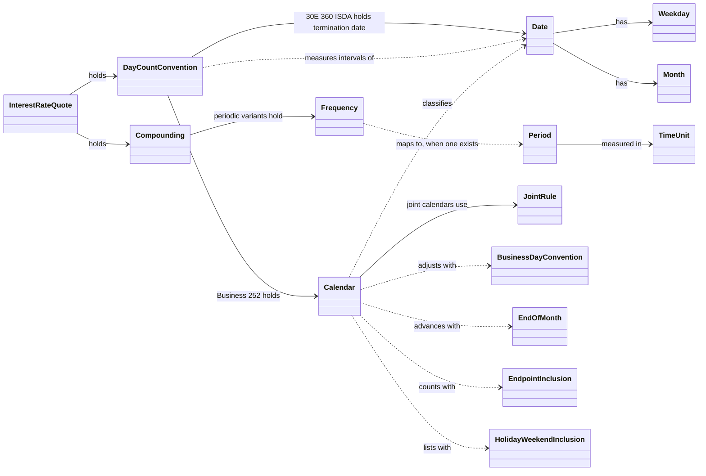
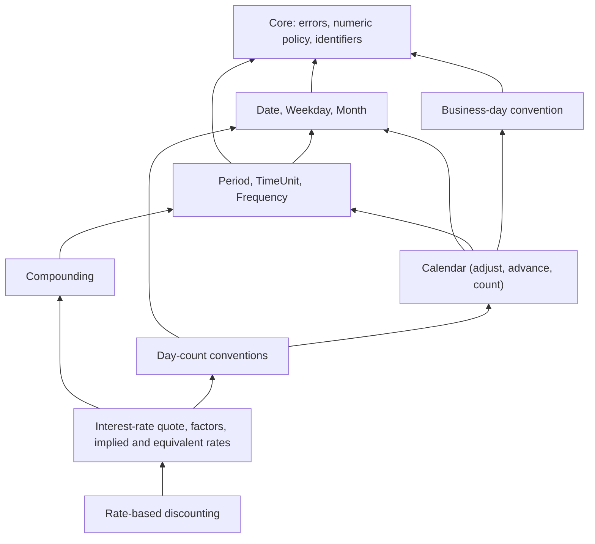

# Domain Model

| Field | Value |
|---|---|
| Milestone | M0 |
| Document status | Draft for project-owner review |
| Related | [REQUIREMENTS](REQUIREMENTS.md) (precise behavior), [ARCHITECTURE](ARCHITECTURE.md) (modules), [API_DESIGN_PRINCIPLES](API_DESIGN_PRINCIPLES.md) |

This document defines the **concepts** of SabiQuant's foundational domains,
how they relate, and how their types prevent misuse. Behavior is specified in
[REQUIREMENTS](REQUIREMENTS.md). Nothing here is code. Names in this document
are conceptual and are settled in each milestone's design review.

Local M5 consistency clarifications are recorded under delegated agent
authority in [REQUIREMENTS §12.2](REQUIREMENTS.md#122-local-m5-consistency-decisions).
They describe the reviewable candidate and do not establish owner API review
or milestone/release acceptance.

---

## 1. Purpose and boundaries

The foundational model covers nine domains: core types, dates, periods and
frequencies, calendars, business-day conventions, day-count conventions,
interest rates, compounding, and rate-based discounting. Concepts from later
domains (schedules, curves, instruments) appear only in §8, to show that the
foundations leave room for them.

## 2. Ubiquitous language

Code, documentation, tests, and issues use these terms with exactly these
meanings.

| Term | Meaning |
|---|---|
| Date | A day in the proleptic Gregorian calendar. No time of day and no time zone |
| Calendar day | Any date |
| Business day | A date on which a given calendar's market is open |
| Holiday | A non-business day, including weekends (QuantLib uses the word the same way). A "weekday holiday" is a holiday that is not a weekend day |
| Weekend | The weekdays that a calendar treats as non-business by default |
| Calendar | A rule set plus data that decides which dates are business days |
| Joint calendar | A calendar made by combining others under *join holidays* or *join business days* |
| Period / tenor | A signed length in Days, Weeks, Months or Years |
| Frequency | Number of regular events per year (Annual = 1 … Daily = 365), or *Once* |
| Business-day convention | The rule that moves a non-business day to a business day |
| Adjustment | Applying a business-day convention to a date |
| Advancement | Moving a date by a count of business days, or by a period followed by adjustment |
| End-of-month (EOM) rule | An option that keeps a month-end date at month end when advancing by months or years |
| Clamping | Reducing the day of month to the target month's length after month arithmetic |
| Accrual period | The interval `[S, E)` over which interest accrues |
| Determination period | ICMA term: a regular coupon period, from one normal interest date to the next, used as the denominator period. QuantLib calls it the "reference period" |
| Notional (quasi-coupon) period | A determination period extended past the actual schedule to measure an irregular stub |
| Termination date | Maturity of the instrument; needed by 30E/360 (ISDA) |
| Day count | Integer number of days between dates under a convention |
| Year fraction | A convention's measure of an interval in years; the day count fraction |
| Day-count convention | The rule that produces a day count and a year fraction |
| Interest-rate quote | A rate together with its day-count convention, compounding and frequency |
| Compounding | How interest is reinvested: Simple, Compounded, Continuous, or a hybrid of Simple and Compounded |
| Compound factor | Growth of one unit over an interval |
| Discount factor | Present value of one unit paid at the end of an interval; the reciprocal of the compound factor |
| Implied rate | The rate that reproduces a given compound factor over a given horizon |
| Equivalent rate | The rate under different conventions that gives the same compound factor over a given horizon |
| Valuation date | The as-of date of a calculation. Always an explicit input, never global |
| Verified coverage | The years for which a calendar's holiday data has been checked against an authoritative source |
| Projected coverage | Years outside verified coverage, where holidays come from rules only |
| Reference fixture | Recorded inputs and expected outputs with provenance, used for differential testing |

## 3. Conceptual model

Solid arrows mean "holds a value of". Dotted arrows mean "operates on".

## 4. Value objects and invariants

All foundational concepts are **value objects**. They are immutable, compared
by value, have no identity apart from their contents, and can be shared
between threads.

| Concept | Kind | Key invariants | Spec |
|---|---|---|---|
| Date | Value | Within the supported range; valid components; total order | FS-DATE |
| Weekday, Month, TimeUnit | Closed enumerations | — | FS-DATE, FS-PER |
| Period | Value | Normalized equality; partial order | FS-PER |
| Frequency | Closed enumeration | Event counts as in FS-PER | FS-PER |
| Business-day convention | Closed enumeration | Seven conventions | FS-BDC |
| End-of-month rule | `EndOfMonth::{Preserve, Ignore}` | Explicit typed option, no Boolean adapter | FS-CAL |
| Endpoint inclusion | `EndpointInclusion::{Include, Exclude}` for each endpoint | Equal-date counting requires both included | FS-CAL |
| Holiday-list weekend inclusion | `HolidayWeekendInclusion::{Include, Exclude}` | Explicitly chooses whether weekend holidays appear in the list | FS-CAL |
| Joint rule | Two-valued enumeration (join holidays / join business days) | — | FS-CAL |
| Calendar | Value (rules plus data) | Classification is pure. All seven weekdays may be closed; business-date overrides and bounded typed search failures remain defined. Market calendars carry queryable provenance/coverage | FS-CAL |
| Day-count convention | Enumeration with parameterized variants | Required parameters present and valid | FS-DCC |
| Compounding | Enumeration; periodic variants hold a periodic frequency | No `Once` or "no frequency" in periodic variants | FS-RATE |
| Interest-rate quote | Value | Finite rate; valid compounding; rate inside its compounding's domain where that can be checked independently of the horizon (e.g., `r > −m`) | FS-RATE |

## 5. Domain operations

All operations are **pure functions** of their inputs. None touches global
state, I/O, or the clock.

| Operation | Inputs | Output | Can fail? | Spec |
|---|---|---|---|---|
| Construct a date | Year, month, day | Date | Yes: invalid components or out of range | FR-DATE-01 |
| Shift a date | Date, days / weeks / months / years | Date | Yes: out of range | FR-DATE-03/04/05 |
| Day difference | Two dates | Signed integer | No | FR-DATE-07 |
| Business-day test | Calendar, date | Boolean | Plain calendars are infallible; guarded TARGET validates market validity and the selected coverage policy | FR-CAL-01 |
| Adjust | Calendar, date, convention | Date | Yes: range or search bound | FR-CAL-04 |
| Advance | Calendar, date, count or period, convention, EOM rule | Date | Yes: range or search bound | FR-CAL-05/06 |
| Count business days | Calendar, two dates, inclusion options | Signed integer | Yes: range | FR-CAL-07 |
| Year fraction | Convention owning its required context, `S`, `E` | `f64` | Yes: invalid accrual coverage or calendar/numeric failures | §9 of REQUIREMENTS |
| Compound or discount factor | Quote, time or dates | `f64` | Yes: domain, overflow | FR-RATE-02 |
| Implied rate | Compound factor, horizon, target conventions | Quote | Yes: domain | FR-RATE-03 |
| Equivalent rate | Quote, target conventions, horizon or dates | Quote | Yes: domain | FR-RATE-04 |
| Present value of one amount | Quote, dates, amount | `f64` | Yes: `E < S`, domain | FR-DISC-01 |

**Per-convention versus per-call parameters.** Parameters fixed for an
instrument's lifetime belong to the day-count convention value: the
termination date for 30E/360 (ISDA), the calendar for Business/252, and an
end-of-month flag for 30/360 (US) if OQ-15 adopts one. Actual/Actual ICMA owns explicit ordered contiguous determination periods
and a contractual frequency. Its fraction queries must fall within that
reference context; no periods or frequencies are inferred
([OQ-21](IMPLEMENTATION_READINESS.md#5-decision-register)).
For `n` explicit ICMA periods and `k` intersected periods, construction is
O(n) and a fraction query is O(log n + k). Positive contiguous segments over
the supported date range bound a valid context to 3,652,058 one-day periods;
this is not an O(1) many-segment computation.

## 6. Typing strategy and misuse prevention

### 6.1 Closed sets are enumerations

Business-day conventions, frequencies, time units, weekdays, months,
compounding methods, joint rules and calendar options use explicit enumerations.
Complete fixed sets such as weekdays and months permit exhaustive matching.
Sets that may grow, such as the supported day-count/accrual conventions, are
non-exhaustive so that later additions preserve API compatibility
([ADR-0009](adr/ADR-0009-api-stability.md)). Stateless variants are small
comparable values; contextual variants own their validated inputs.

### 6.2 Open extension is deliberate and limited

User-defined calendars are needed in practice. They are supported through
*custom calendars* (weekend set plus explicit holiday dates) and *joint
calendars*. A public trait for arbitrary user calendar rules is **deferred**
until a concrete need appears; it would be a permanent API commitment.
User-defined day-count conventions are not supported in H1. Extension points
are listed in [ARCHITECTURE §9](ARCHITECTURE.md#9-extension-points).

### 6.3 Required parameters live inside convention values

Where a convention needs a parameter, its type carries it. A 30E/360 (ISDA)
value cannot exist without its termination date, and a Business/252 value
cannot exist without its calendar. QuantLib allows these to be omitted (the
termination date) or defaulted (the Brazil calendar). SabiQuant does not.
The local M3 API keeps stateless `DayCount` variants `Copy`; separate
`ThirtyE360Isda`, `Business252` and `ActualActualIcma` types enforce state.
A guarded TARGET calendar cannot escape into an unchecked plain calendar.

**Names versus values.** A catalog label identifies a convention or calendar
family, and supported identifier enums round-trip through their canonical
text. That label does not encode the owned context: it cannot reproduce ICMA
reference periods, termination dates, a custom/joint calendar or TARGET's
coverage policy and overrides. H1 does not promise full-value or graph
serialization. Explicit constructors are required; neither a parser nor a
default supplies missing financial inputs. `TargetCalendar::new()` is an
explicit strict-coverage choice and has no `Default` implementation.

### 6.4 Scalar wrapper types ([OQ-24](IMPLEMENTATION_READINESS.md#5-decision-register))

| Option | Description | Benefit | Cost |
|---|---|---|---|
| A. Plain `f64` (chosen locally for H1) | Year fractions, rates, factors and amounts are `f64`, validated at the boundary | Simple arithmetic and interop; small API | A time could be passed where a rate is expected |
| B. Wrappers for year fraction and discount factor only | Two validated wrapper types | Stops time/factor confusion at the most common boundary | Conversion noise; operator implementations needed |
| C. Full dimensional types | Wrappers for every quantity | Maximum safety | Heavy API; arithmetic boilerplate; no benefit shown yet |

**Local OQ-24 choice: A for H1, subject to owner API review.** The values most often confused (a rate together
with its conventions) are already carried by the interest-rate quote, so most
operations take one bare `f64` (time or amount) next to typed values. The
choice will be revisited after the M4 API review, using real usage
(reconsideration trigger in [ADR-0006](adr/ADR-0006-numeric-policy.md)).

### 6.5 No boolean traps

QuantLib uses booleans for the end-of-month option and for the
include-first/include-last options of business-day counting. SabiQuant uses
`EndOfMonth`, `EndpointInclusion` and `HolidayWeekendInclusion`, each with
descriptive variants and exact identifier parsing. These separate options
make advancement, endpoint counting and list filtering explicit at the call
site ([API_DESIGN_PRINCIPLES §4](API_DESIGN_PRINCIPLES.md#4-type-and-signature-principles)).

### 6.6 Conventions cannot be mixed by accident

A date-based rate calculation uses the **quote's** day-count convention. A
caller cannot compute a year fraction with one convention and apply a rate
quoted under another, unless they deliberately use the time-based form with
a year fraction they computed themselves.

### 6.7 Units are explicit

Rates are decimals. There is no percent input mode. Percent and basis-point
conversions are explicit, named operations (FR-CORE-07).

### 6.8 No "null" states

There is no null/unset date, calendar or rate sentinel. Optional values
express absence, and invalid values cannot be built. `Calendar::null()` is
an explicit valid all-business-days rule, not an absent calendar. QuantLib's
`Date()` null date and `Null<Real>` sentinels have no equivalent.

## 7. Concept dependencies (foundations)

The graph has no cycles. Only Business/252 creates the dependency of day
counts on calendars.

## 8. Outlook: concepts of future domains

These are directions, not decisions. Each is settled by an ADR when its
milestone is planned.

| Future concept | QuantLib analogue | Direction for SabiQuant | Milestone |
|---|---|---|---|
| Schedule | `Schedule`, `DateGenerationRule` | Value built from rules. Notional periods available for ICMA | M7 |
| Cash flow, coupon, leg | `CashFlow`, `Coupon`, leg builders | Enum of cash-flow kinds plus data; analytics as pure functions | M7 |
| Valuation (market) context | `Settings` plus handles | Immutable snapshot: valuation date, curves, fixings, quotes. Passed explicitly | M9 |
| Yield curve | `YieldTermStructure` | Immutable curve values with an explicit reference date and extrapolation policy | M9 |
| Fixing history | `IndexManager` | Explicit value inside the context; no global store | M10 |
| Instrument | `Instrument` subclasses | Plain data describing contractual terms | M8+ |
| Pricing method (engine) | `PricingEngine` | A value implementing a pricing capability for instrument types; returns results, no hidden caching | M10+ |
| Stochastic process, model | `StochasticProcess`, models | Values; simulation state explicit; seeds explicit | M13+ |
| Scenario or bump | Relinking handles, then recalculation | A new context derived from an old one; reprice | M16 |
