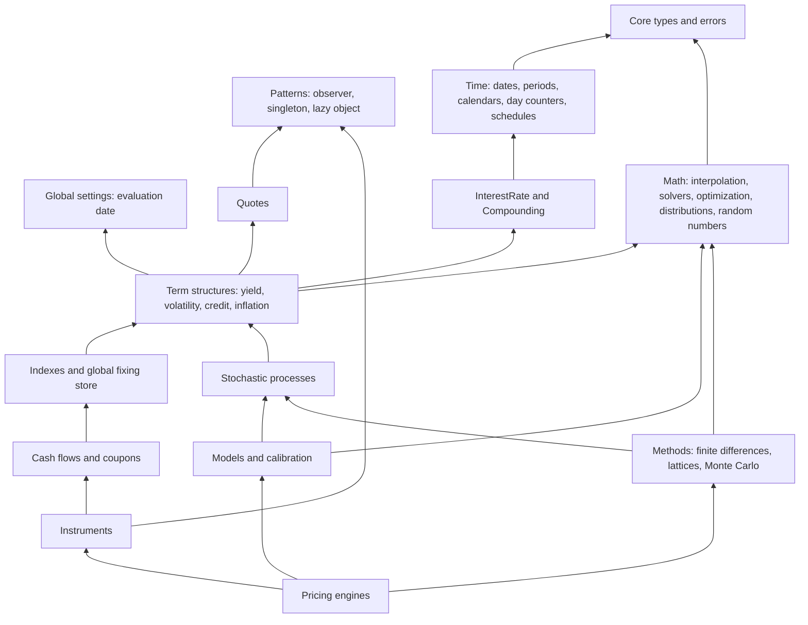

# QuantLib Reference Baseline and Analysis

| Field | Value |
|---|---|
| Milestone | M0 |
| Document status | Draft for project-owner review |
| Research date | 2026-10-10 |
| Related | [ADR-0003](adr/ADR-0003-quantlib-compatibility.md), [ADR-0008](adr/ADR-0008-validation-strategy.md), [FEATURE_MATRIX](FEATURE_MATRIX.md), [LICENSING_AND_ATTRIBUTION](LICENSING_AND_ATTRIBUTION.md) |

## 1. Purpose and usage policy

QuantLib is SabiQuant's **external behavioral and numerical reference**. Per
the owner constraints C-03 and C-04 ([REQUIREMENTS §1](REQUIREMENTS.md#1-owner-constraints)),
QuantLib is used to:

- identify relevant functionality;
- study domain behavior and conventions;
- compare numerical outputs through differential tests;
- discover edge cases.

QuantLib is **never** used as a source of code. This document describes
QuantLib's behavior in SabiQuant's own words, cites file paths for
traceability, and quotes nothing beyond short identifiers. Every behavioral
statement here was found by **reading source at the pinned tag**. It is a
*hypothesis* until a differential fixture confirms it (see §10, L-08).

## 2. Reference baseline

| Item | Value | How verified |
|---|---|---|
| Project | QuantLib, <https://github.com/lballabio/QuantLib> | Repository metadata |
| Pinned version | **1.43** (`QL_VERSION "1.43"`, `QL_HEX_VERSION 0x014300f0` in `ql/version.hpp`) | Read at the tag |
| Tag | `v1.43` (annotated tag object `1139fefe63bfb36695448337c1367b73ff215353`) | `git ls-remote` |
| Commit | **`6b57206e04598f092efee66e3b367efc84771995`**, committed 2026-07-13, "Update changelog" | Shallow clone at the tag |
| GitHub release | "1.43", published 2026-07-14 | GitHub releases API |
| Python package | `QuantLib` 1.43 on PyPI, wheels uploaded 2026-07-14, package metadata licence BSD-3-Clause | PyPI JSON API |
| Next version | `v1.44-rc` pre-release, published 2026-10-03 (commit `28976268a65344ef07aaf89dca0ecc692aedbaf5`). **Not** used as baseline | GitHub releases API |
| Previous releases | 1.42.1 (2026-04-17), 1.42 (2026-04-14), 1.41 (2026-01-13), 1.40 (2025-10-14) | GitHub releases API |
| Language and build | C++17 or later (CMake enforces it); Boost required | `CMakeLists.txt` |
| Licence | Modified BSD (BSD 3-Clause) | [quantlib.org/license.shtml](https://www.quantlib.org/license.shtml), `LICENSE.TXT`, README badge |
| Default branch | `master` | Repository metadata |

**Why 1.43.** It is the latest **stable** release on the research date. A
release candidate is not a stable reference, and pinning to a commit on
`master` would give a moving target. Matching Python wheels exist, which
makes reproducible fixture generation possible ([ADR-0008](adr/ADR-0008-validation-strategy.md)).

## 3. Sources consulted

| Source | URL | Used for |
|---|---|---|
| QuantLib repository at `v1.43` | <https://github.com/lballabio/QuantLib/tree/v1.43> | Structure, foundational behavior, tests, licence file, release notes |
| QuantLib licence page | <https://www.quantlib.org/license.shtml> | Licence terms |
| QuantLib documentation index | <https://www.quantlib.org/docs.shtml> | Available documentation |
| QuantLib reference manual | <https://www.quantlib.org/reference/> | Listed as official. The version is not stated on the index page (L-06) |
| QuantLib release history | <https://www.quantlib.org/reference/history.html> | Referenced from the README |
| GitHub releases API | <https://api.github.com/repos/lballabio/QuantLib/releases> | Release dates |
| PyPI QuantLib | <https://pypi.org/project/QuantLib/> | Wheel availability |

Documentation listed on the QuantLib site but **not** used as specification
sources: *Implementing QuantLib* and *A QuantLib Guide* (L. Ballabio), and the
*QuantLib Python Cookbook*. These are copyrighted books. SabiQuant may cite
them for background but must not reproduce them.

## 4. Repository structure (v1.43)

`ql/` holds **1,440** header files and **974** source files.

| Directory | Headers | Domain |
|---|---:|---|
| `ql/time` | 81 | Dates, periods, frequencies, weekdays, business-day conventions, calendars (`calendars/`: 54 headers, 48 of them country or market calendars), day counters (`daycounters/`: 12 headers, including a test-helper counter and an inverse helper), schedules and date-generation rules, IMM/ASX/ECB dates |
| `ql/math` | 179 | `interpolations`, `solvers1d`, `optimization`, `distributions`, `integrals`, `randomnumbers`, `matrixutilities`, `statistics`, `copulas`, `ode` |
| `ql/methods` | 148 | `finitedifferences`, `lattices`, `montecarlo` |
| `ql/termstructures` | 132 | `yield`, `volatility`, `credit`, `inflation` |
| `ql/pricingengines` | 173 | `vanilla`, `barrier`, `asian`, `basket`, `bond`, `swap`, `swaption`, `capfloor`, `credit`, `inflation`, `lookback`, `cliquet`, `forward`, `futures`, `quanto`, `exotic` |
| `ql/instruments` | 91 | Options, swaps, FRAs, caps and floors, swaptions, CDS; `bonds/` (zero-coupon, fixed, floating, amortizing, CMS, CPI, convertible) |
| `ql/models` | 159 | `shortrate`, `equity`, `marketmodels`, `volatility` |
| `ql/indexes` | 69 | `ibor`, `swap`, `inflation`, plus the index manager |
| `ql/cashflows` | 36 | Coupons, legs, coupon pricers, cash-flow analytics |
| `ql/processes` | 22 | Stochastic processes |
| `ql/quotes` | 12 | Market quotes |
| `ql/currencies` | 8 | Currencies |
| `ql/patterns` | 6 | Observable, singleton, lazy object, visitor, curiously recurring template |
| `ql/utilities` | 11 | Data parsers and formatters, null values, observable values, and others |
| `ql/experimental` | 251 | Experimental features |
| `ql/legacy` | 17 | Legacy components |
| `ql/*.hpp` (top level) | — | `types`, `errors`, `settings`, `interestrate`, `compounding`, `instrument`, `pricingengine`, `cashflow`, `termstructure`, `handle`, `quote`, `stochasticprocess`, `timegrid`, `money`, `currency`, and others |

The test suite (`test-suite/`) has a file for each foundational area:
`dates.cpp`, `period.cpp`, `calendars.cpp`, `businessdayconventions.cpp`,
`daycounters.cpp`, `interestrates.cpp`, `schedule.cpp`.

## 5. Foundational behavior observed (v1.43)

Each note gives the file it comes from. SabiQuant's specifications, which are
not always identical, are in [REQUIREMENTS](REQUIREMENTS.md).

| ID | Area | Observed behavior | File(s) |
|---|---|---|---|
| B-01 | Date range | Valid serials 367–109574, i.e. 1901-01-01 to 2199-12-31. Serials follow the Excel/Applix convention. The leap-year table treats 1900 as a leap year "in agreement with Excel's bug" (outside the valid range) | `ql/time/date.cpp`, `date.hpp` |
| B-02 | Month and year arithmetic | Adding months clamps the day to the target month's length. Adding years moves 29 February to 28 February in a common year | `ql/time/date.cpp` (`Date::advance`) |
| B-03 | End of month | `Date::isEndOfMonth` is about calendar days. `Calendar::isEndOfMonth(d)` is true when `d` is on or after the last business day of its month | `date.hpp`, `calendar.hpp` |
| B-04 | Adjustment | Seven business-day conventions. Half-Month Modified Following falls back to Preceding when Following crosses the 15th or the month end. Nearest searches outward symmetrically; a tie goes to the following day | `ql/time/businessdayconvention.hpp`, `calendar.cpp` |
| B-05 | Advancement | `n = 0`: adjust. Days: count business days and ignore the convention. Weeks: add 7n days, then adjust. Months and years: clamp, then apply the end-of-month rule (Unadjusted uses the last calendar day, other conventions use the last business day), otherwise adjust | `calendar.cpp` |
| B-06 | Business-day counting | By default the start is included and the end excluded. Reversed arguments give the negative count with the inclusion flags swapped. Equal dates count 1 only if both ends are included and the date is a business day | `calendar.cpp` |
| B-07 | Calendar state | Built-in calendars share a static implementation object. `addHoliday` and `removeHoliday` change it, which affects every instance of that calendar in the process | `calendar.cpp`, e.g. `calendars/target.cpp` |
| B-08 | Easter | Easter Monday comes from precomputed tables for 1901–2199, one Western and one Orthodox | `calendar.cpp` |
| B-09 | Joint calendars | `JoinHolidays` (the default) and `JoinBusinessDays`; up to four calendars, or a vector | `calendars/jointcalendar.hpp` |
| B-10 | TARGET | Weekends; 1 January; 25 December; Good Friday, Easter Monday, 1 May and 26 December from 2000; 31 December in 1998, 1999 and 2001 | `calendars/target.cpp` |
| B-11 | Day counters | Actual/360 (optionally including the last day), Actual/364, Actual/365.25, Actual/365 Fixed (Standard, Canadian, NoLeap), Actual/366, Actual/Actual (ISMA = Bond; ISDA = Historical = Actual365; AFB = Euro), Business/252, 1/1, Simple, 30/360 (USA, BondBasis = ISMA, European = EurobondBasis, Italian, German = ISDA, NASD), 30/365, and a "year fraction to date" helper | `ql/time/daycounters/*` |
| B-12 | Actual/Actual | ISDA splits the period by calendar year. Without a schedule, ISMA infers the period length as `round(12 × days / 365)` months and falls back to the accrual dates (or one year from the start) as the reference period. With a schedule, it uses the schedule's periods. AFB counts whole years back from the end date, moving 28 February of a leap year to 29 February. All three negate the result for reversed dates | `actualactual.cpp` |
| B-13 | 30/360 | US rule order: February rules first, then the 31st rules. German/ISDA needs the termination date. Per its documented rules, NASD gives day counts algebraically identical to Bond Basis. Reversed dates are not negated: the formula is applied directly | `thirty360.hpp/.cpp` |
| B-14 | Business/252 | Default calendar is Brazil. Business-day counts are memoized in process-wide maps keyed by calendar name | `business252.hpp/.cpp` |
| B-15 | 1/1 | Returns 1 when `d2 ≥ d1` (including equal dates) and −1 otherwise | `daycounters/one.hpp` |
| B-16 | Actual/365 | The header warns that, according to ISDA, plain "Actual/365" is an alias of Actual/Actual (ISDA) | `actual365fixed.hpp` |
| B-17 | Interest rate | Periodic and hybrid compounding need a frequency other than `Once` or `NoFrequency`. The compound factor needs `t ≥ 0`. The implied rate needs a compound factor `> 0`, and `t = 0` is allowed only when the compound factor is 1 (giving rate 0). Formulas use `pow`, `exp` and `log` directly, with no check that `1 + r/m > 0` | `ql/interestrate.cpp` |
| B-18 | Enumerations | Compounding: Simple, Compounded, Continuous, SimpleThenCompounded, CompoundedThenSimple. Frequency: NoFrequency = −1, Once = 0, Annual = 1, …, Daily = 365, OtherFrequency = 999. TimeUnit includes intraday units for the optional high-resolution date build | `compounding.hpp`, `time/frequency.hpp`, `time/timeunit.hpp` |
| B-19 | Global state | `Settings` is a singleton holding the evaluation date and event-inclusion flags. `IndexManager` is a singleton holding historical fixings. Singletons can be made thread-local with `QL_ENABLE_SESSIONS` | `settings.hpp`, `indexes/indexmanager.hpp`, `patterns/singleton.hpp` |
| B-20 | Errors and comparison | `QL_REQUIRE`, `QL_ENSURE` and `QL_FAIL` raise exceptions. The default floating-point closeness test uses a fixed `42 × QL_EPSILON` | `errors.hpp`, `math/comparison.hpp` |
| B-21 | Deprecation cadence | 1.43 removed the features deprecated in 1.38. Features deprecated in 1.43 are expected to be removed "probably" in 1.48 | `News.md` |

## 6. Architecture analysis: what transfers to Rust

| QuantLib concept | QuantLib mechanism | Verdict | SabiQuant direction | Rationale |
|---|---|---|---|---|
| Date | Value class over an Excel-compatible serial; range 1901–2199 | **Adapt** | Serial-day value type with a wider range and ISO text form. Excel serials are not the default ([ADR-0005](adr/ADR-0005-date-representation.md)) | Value semantics fit Rust. The narrow range is a legacy limit |
| Period, Frequency, TimeUnit, BDC, Compounding | C++ enums and small value classes | **Keep (as Rust enums)** | Closed, non-exhaustive enumerations; no `OtherFrequency`; no intraday units in H1 | Direct fit; exhaustive matching |
| Calendar | Bridge to a shared implementation; static shared instances; mutation through `addHoliday` | **Adapt** | Immutable calendar values. Changes produce new values. Built-ins are rule definitions with provenance | Shared mutable state breaks determinism and thread safety |
| Day counter | Bridge with virtual implementation; optional reference-period arguments; process-wide cache in Business/252 | **Adapt** | Enumeration of conventions whose variants carry the parameters they need; no global caches | A closed set suits an enum, and required parameters are enforced by the type |
| InterestRate | Value class: rate, day counter, compounding, frequency | **Keep the concept** | Immutable quote value; typed errors; numerically stable formulations | Sound domain concept |
| Errors | Exceptions raised through macros | **Drop** | `Result` with typed error enumerations ([ADR-0007](adr/ADR-0007-error-handling.md)) | Rust has no exceptions; failure becomes explicit |
| `Null<T>` sentinels | Magic values | **Drop** | Optional values | Idiomatic and type-safe |
| Global evaluation date | `Settings` singleton | **Drop** | Explicit valuation date and context values ([ADR-0011](adr/ADR-0011-explicit-state.md)) | Reproducibility, testability, concurrency |
| Fixing store | `IndexManager` singleton | **Drop** | Fixing histories passed in explicitly (future milestones) | Same reasons |
| Observer / Observable, Handle / RelinkableHandle, LazyObject | Mutable object graph with notifications and lazy recalculation | **Drop for now** | Immutable snapshots, explicit recomputation, and dependency passing. Caching only inside explicit context objects (future ADR) | Shared-ownership graphs with interior mutability fight Rust ownership and hide control flow |
| Instrument + PricingEngine | Engines filled through `arguments` / `results` objects; instruments cache results | **Adapt (future)** | Instruments as plain data. Pricing methods are values that turn (instrument, context) into results, with no downcasting and no hidden caches | Ownership-friendly, testable, thread-safe |
| Visitor over cash flows | Acyclic visitor | **Adapt** | Enum plus `match` for closed sets; traits for open extension | Idiomatic Rust |
| Configurable `Real` | Typedef that can be swapped | **Adapt** | Concrete `f64` in H1 ([ADR-0006](adr/ADR-0006-numeric-policy.md)) | Simplicity; generic numerics are deferred |
| Default closeness test | Fixed 42ε | **Drop as a default** | Tolerances per quantity, justified by conditioning ([NUMERICAL_CORRECTNESS §7](NUMERICAL_CORRECTNESS.md#7-tolerance-policy)) | No single global epsilon |
| Boost | Required dependency | **Drop** | Standard library only ([ADR-0002](adr/ADR-0002-standard-library-only.md)) | Owner constraint |
| Domain layering | time → rates → term structures → indexes → cash flows → instruments → engines | **Keep the dependency order** | The same broad order, as modules of a single crate ([ARCHITECTURE](ARCHITECTURE.md)) | Domain dependencies are inherent to finance, not to C++ |

## 7. Domain dependency graph (QuantLib, simplified)

The graph below simplifies the domain relationships from the directory layout
and the foundational headers. It is not a complete include graph. An arrow
`A --> B` means "A depends on B".

Observations:

1. **Time and rates sit at the bottom.** Every higher domain depends on dates,
   calendars, day counts, and rates. That is why they are SabiQuant's
   foundations.
2. **Global state enters through term structures and indexes.** The
   evaluation date and the fixing store are reached from the middle layers, so
   SabiQuant's explicit-state design ([ADR-0011](adr/ADR-0011-explicit-state.md))
   matters most from M9 onwards.
3. **Math is a shared foundation with no financial dependencies.** In
   SabiQuant it becomes the `math` module, introduced in M6 before curves need
   solvers and interpolation ([ROADMAP](ROADMAP.md)).

## 8. Known reference-side issues and ambiguities

QuantLib is not presumed correct ([ADR-0003](adr/ADR-0003-quantlib-compatibility.md)).
Issues already found:

| ID | Issue | Evidence | Handling |
|---|---|---|---|
| QR-01 | One Actual/Actual (ISDA) test case (2003-07-15 → 2004-01-15) is annotated in QuantLib's own test suite as disagreeing with an ISDA market-conventions document (`mktc1198.pdf`) | `test-suite/daycounters.cpp` | Resolve from primary ISDA sources. Record in the discrepancy log |
| QR-02 | QuantLib's 30/360 US applies the February rules unconditionally. Secondary sources apply them only to end-of-month securities | `thirty360.hpp`; [Wikipedia: Day count convention](https://en.wikipedia.org/wiki/Day_count_convention); [Cbonds glossary](https://cbonds.com/glossary/30-360-us/) | OQ-15 |
| QR-03 | QuantLib's ICMA without a schedule infers the period length heuristically. The ICMA rule needs explicit determination periods | `actualactual.cpp`; ICMA PMH Appendix A5 | OQ-21 (SabiQuant requires explicit inputs) |
| QR-04 | QuantLib's AFB counting-back rule produces 1 + 1/365 for 2024-02-28 → 2025-02-28 | Derived from `actualactual.cpp` | OQ-16 |
| QR-05 | NASD 30/360 rules reduce to Bond Basis algebraically | Derived from `thirty360.cpp` | Confirm by differential testing. Decide whether a separate convention is needed |

## 9. Re-baselining policy (proposed)

1. **Pin.** M1–M5 use QuantLib 1.43 at commit `6b57206e…`. Every fixture
   records the baseline it was generated from.
2. **Watch.** At each milestone boundary, review the QuantLib release notes and
   change log since the pin for changes to foundational behavior.
3. **Re-baseline only at milestone boundaries.** Regenerate all fixtures with
   the new version and diff them against the old ones. Classify every changed
   value under the discrepancy taxonomy ([TESTING_STRATEGY §7.5](TESTING_STRATEGY.md#75-discrepancy-classification)).
4. **Record.** Update §2 of this document and note the change in the
   CHANGELOG once one exists.
5. **Deprecations.** QuantLib removes deprecated features about five releases
   later (B-21), so features studied here may disappear in future baselines.
   SabiQuant's behavior is defined by its own specifications, not by QuantLib
   continuing to exist.

Recommendation: keep 1.43 through M2. Consider 1.44 (in release-candidate
stage on the research date) when M3 is planned.

## 10. Research limitations

| ID | Limitation | Consequence |
|---|---|---|
| L-01 | The ISDA 2006 Definitions and the 2021 Interest Rate Derivatives Definitions are licensed publications and were **not consulted**. Section numbers are cited from secondary sources | Convention texts must be checked by someone with licensed access ([R-02](IMPLEMENTATION_READINESS.md#6-risk-register)) |
| L-02 | ISDA's 1999 paper *The Actual/Actual Day Count Fraction* (<https://www.isda.org/a/pIJEE/The-Actual-Actual-Day-Count-Fraction-1999.pdf>) is an **image-only scan**. Its text could not be extracted in this session | Worked examples were checked by independent recomputation and against QuantLib's test data. The text must be transcribed by hand in M3 |
| L-03 | SIFMA's primary definition of 30/360 US was not retrieved, and secondary sources conflict | OQ-15 |
| L-04 | No primary source was found for Actual/Actual (AFB) | OQ-16 |
| L-05 | No primary source (for example ANBIMA) was retrieved for Business/252 | Status Under Research for exact conventions |
| L-06 | The QuantLib reference manual's version is not stated on the documentation index | Source code at the pinned tag was used instead |
| L-07 | Only the foundational areas of QuantLib were read at source level. The advanced domains in [FEATURE_MATRIX](FEATURE_MATRIX.md) come from the directory and header structure | Future milestones need their own research |
| L-08 | **No QuantLib build or QuantLib-Python run was performed in M0.** Behavior notes come from reading source and tests | Every B-xx note must be confirmed by fixtures in M2–M5 |
| L-09 | The scan of other Rust projects was one web search | Informational only ([VISION §7](VISION.md#7-landscape-informational)) |
| L-10 | ICMA's definition was taken from the public *Primary Market Handbook, Appendix A5* (March 2022), not from the ICMA Secondary Market Rules (Rule 251) | Rule 251's text should be checked if secondary-market accrual becomes in scope |
