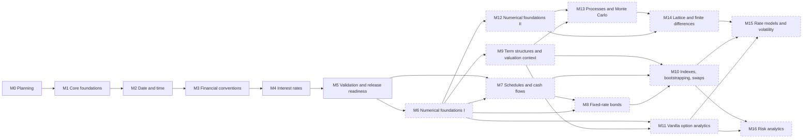

# Roadmap

| Field | Value |
|---|---|
| Milestone | M0 and M1 (merged); M2–M6 foundations and scoped M7–M8 analytics (local validation) |
| Document status | Accepted for M0/M1; M2 authorized under delegated authority ([M2_READINESS](M2_READINESS.md)) |
| Related | [SCOPE](SCOPE.md), [FEATURE_MATRIX](FEATURE_MATRIX.md), [IMPLEMENTATION_READINESS](IMPLEMENTATION_READINESS.md) |

The roadmap is milestone-driven and has **no calendar dates**. A milestone
starts only when its dependencies are met and the project owner has
authorized it. M1 additionally needs every readiness gate to pass
([IMPLEMENTATION_READINESS](IMPLEMENTATION_READINESS.md)). Milestones after M5
are provisional and are re-planned once the foundations are validated.

Local M6/M7/M8 staging is an explicit exception under the owner's later instruction
to continue local work. It produces a reviewable candidate and evidence while
the formal dependency/review gates remain open; it does not waive the
Definition of Done or authorize publication.

## Milestone status

| Milestone | Status | Evidence |
|---|---|---|
| M0 Planning | **Complete** | Documentation merged in pull request #1. The owner decided the M1-blocking questions on 2026-10-10 ([decision register](IMPLEMENTATION_READINESS.md#5-decision-register)) |
| M1 Core foundations | **Complete** | Merged in [PR #2](https://github.com/iceman951/sabiquant/pull/2); all six jobs in [CI run 38061356805](https://github.com/iceman951/sabiquant/actions/runs/38061356805) passed |
| M2 Date and time | **In progress** (local work authorized 2026-10-11) | [M2_READINESS](M2_READINESS.md), [M2_VALIDATION](M2_VALIDATION.md) |
| M3 Financial conventions | Ten explicitly specified conventions and TARGET implemented locally; milestone acceptance pending | [M3_LOCAL_READINESS](M3_LOCAL_READINESS.md), [M3_CORE_VALIDATION](M3_CORE_VALIDATION.md); [M3_EXTENSION_VALIDATION](M3_EXTENSION_VALIDATION.md); [US/AFB contract](M3_US_AFB_CONTRACT.md); full SIFMA source acceptance, maintenance and native CI/review remain |
| M4 Interest rates | Local implementation and numerical validation in progress under delegated authority | [M4_LOCAL_READINESS](M4_LOCAL_READINESS.md), [M4_NUMERICAL_VALIDATION](M4_NUMERICAL_VALIDATION.md); native primary-platform CI and milestone review remain |
| M5 Foundational review | Local API/package/validation review and corrective work in progress under delegated authority | [M5_LOCAL_READINESS](M5_LOCAL_READINESS.md), [M5_LOCAL_VALIDATION](M5_LOCAL_VALIDATION.md); owner review, native platform CI and release decisions remain |
| M6 Numerical foundations I | Local implementation, independent oracle/convergence evidence and packaged-source checks recorded; formal M5 dependency and milestone acceptance remain pending | [M6_LOCAL_READINESS](M6_LOCAL_READINESS.md), [M6_NUMERICAL_VALIDATION](M6_NUMERICAL_VALIDATION.md), [M6_LOCAL_NUMERICAL_REVIEW](M6_LOCAL_NUMERICAL_REVIEW.md), [M6_TRACEABILITY_AUDIT](M6_TRACEABILITY_AUDIT.md) |
| M7 Schedules and cash flows | Local Forward/Backward/Zero, explicit dates/same-lattice ICMA, four civil rolls, modern CDS/CDS2015 quoted maturities and Following date plans, the automatic local OldCDS rule, plus analytical simple/fixed flows, legs, flat NPV/outstanding accrual. All ten rule labels are constructible; OldCDS/full SIFMA financial acceptance, source-complete named settlement and full acceptance remain pending | [M7_LOCAL_READINESS](M7_LOCAL_READINESS.md), [M7_ROLL_ICMA_CONTRACT](M7_ROLL_ICMA_CONTRACT.md), [M7_CASHFLOW_CONTRACT](M7_CASHFLOW_CONTRACT.md), [M7_CDS_CONTRACT](M7_CDS_CONTRACT.md), [M7_CDS_VALIDATION](M7_CDS_VALIDATION.md), [M7_OLD_CDS_CONTRACT](M7_OLD_CDS_CONTRACT.md), [M7_OLD_CDS_VALIDATION](M7_OLD_CDS_VALIDATION.md) |
| M8 | Source/API readiness, exact decimal foundation, binary64 boundary, explicit exact settlement recipes, and local bond core (`Bond::zero_coupon`, `Bond::fixed_rate`, explicit settlement/ex-coupon entitlement, earned-minus-detached accrual, single-rounding per-100 quote conversion, and two-stage direct-horizon `BondPricingPlan`/`BondValuation`) staged locally; generic bounded yield inversion and all six risk views plus complete conventional UK gilt source price/yield/risk and four exact cash recipes are implemented locally; complete fixed-principal US Treasury price/yield/six-risk/four-cash is implemented locally with final verification recorded separately; Canadian, analytical enclosures and formal acceptance remain pending | [M8_LOCAL_READINESS](M8_LOCAL_READINESS.md), [amount contract](M8_AMOUNT_CONTRACT.md), [binary boundary contract](M8_BINARY_BOUNDARY_CONTRACT.md), [settlement contract](M8_SETTLEMENT_CONTRACT.md), [settlement validation](M8_SETTLEMENT_VALIDATION.md), [bond core contract](M8_BOND_CORE_CONTRACT.md), [bond core validation](M8_BOND_CORE_VALIDATION.md), [contextual bond oracle](M8_BOND_CONTEXTUAL_ORACLES.md), [generic yield/risk contract](M8_BOND_YIELD_RISK_CONTRACT.md), [conventional gilt contract](M8_GILT_CONTRACT.md), [gilt validation](M8_GILT_VALIDATION.md), [Treasury validation](M8_US_TREASURY_VALIDATION.md) |
| M9 to M16 | Not started | Each needs its own readiness check and authorization |

The modern CDS date tranche retains explicit regime, maturity and calendar
inputs. It does not provide CDS premium-leg valuation, repricing, legal
protection dates or settlement. The automatic OldCDS rule completes the
F-SCHED-01 rule families as a local engineering definition
([contract](M7_OLD_CDS_CONTRACT.md)); its historical financial specification
remains open in the [legacy source review](M7_CDS_LEGACY_SOURCE_REVIEW.md).
Native primary-platform, financial/owner and full milestone acceptance gates
remain open.

---

## 1. Milestone dependency graph

## 2. Definition of Done for implementation milestones

These criteria apply to M1 onwards, on top of each milestone's own criteria:

1. The implementation matches the specifications in force, and any change to
   a specification was approved by the owner in the same or an earlier pull
   request.
2. All work is merged through pull requests that pass the review checklist
   ([CONTRIBUTING_GUIDELINES §5](CONTRIBUTING_GUIDELINES.md#5-financial-correctness-requirements-for-contributions)).
3. All tests pass on every primary platform (OQ-08).
4. Public items are fully documented ([API_DESIGN_PRINCIPLES §10](API_DESIGN_PRINCIPLES.md#10-documentation-requirements)).
5. The traceability table, the feature matrix statuses, the discrepancy log,
   and the changelog are updated.
6. The package manifest still declares no dependencies (NFR-09).
7. The owner has accepted the milestone review.

---

## 3. Foundational milestones (M0–M5)

### M0 — Research, specification, architecture and planning

| Field | Content |
|---|---|
| Objective | A complete, consistent, defensible blueprint for SabiQuant before any implementation |
| Scope | Research (QuantLib 1.43 baseline, conventions, Rust std); vision, scope, requirements, domain model, architecture, ADRs, numerical policy, testing strategy, roadmap, governance, licensing analysis, readiness assessment |
| Deliverables | `README.md`; `docs/` (14 documents); `docs/adr/` (index plus ADR-0001 to ADR-0011); a draft pull request from `docs/m0-planning` |
| Dependencies | None |
| Risks | Primary sources not accessible (R-02); behavior notes not yet confirmed by execution (L-08) |
| Non-goals | Any code, Cargo initialization, CI, fixtures, or scripts in the repository |
| Acceptance criteria | Every deliverable exists and cross-links correctly; Gates A–E assessed with evidence; the repository diff holds only Markdown; open decisions and risks are listed |
| Definition of Done | The owner has reviewed the draft pull request, merged it (owner action), and recorded decisions on the OQs that block M1 |
| Verification evidence | Draft pull request diff (Markdown only); link check of all internal references; [IMPLEMENTATION_READINESS](IMPLEMENTATION_READINESS.md) |

### M1 — Core foundations

| Field | Content |
|---|---|
| Objective | The engineering foundation that all domain work builds on |
| Scope | Initialize the single crate (ADR-0004) with a manifest that has no dependencies, edition 2024, the declared MSRV, and the lint policy (no unsafe; missing docs is an error). The `error` and internal `numeric` modules. Error conventions (ADR-0007). Numeric validation (NP-01, NP-02). Identifier infrastructure (FR-CORE-05/06). Test support: deterministic PRNG, ULP and tolerance comparison, fixture reader (F-CORE-05/06). Cross-platform CI. Governance files once their decisions are made: licence files, root `CONTRIBUTING.md`, `SECURITY.md`, `CHANGELOG.md` |
| Deliverables | Crate skeleton with the foundational modules; tests for all M1 code; CI configuration; governance files; updated docs |
| Dependencies | Gate F passed. OQ-01 to OQ-08 decided. OQ-13 decided before the fixture reader is built |
| Risks | Over-engineering the error framework; CI maintenance cost; M1 scope creeping into M2 |
| Non-goals | Dates, periods, calendars, conventions, rates; publishing to crates.io |
| Acceptance criteria | Builds with zero dependencies on the primary platforms. TS-CORE-01 passes for the M1 error infrastructure. PRNG reproducible across platforms (the same sequence everywhere). Fixture reader rejects malformed input with typed errors. Lints enforced |
| Definition of Done | §2, plus the ADRs for M1 accepted |
| Verification evidence | CI runs on every primary platform; manifest review; test report; documentation build without missing-docs warnings |

### M2 — Date and time

| Field | Content |
|---|---|
| Objective | Exact, validated dates, periods and frequencies (FS-DATE, FS-PER) |
| Scope | F-TIME-01 to F-TIME-08 and F-TIME-10 to F-TIME-14; the reference generator, version 1 (ADR-0008); date and period fixtures (QuantLib and oracle); initialize the discrepancy log |
| Deliverables | `time` module; TS-DATE-01…07 and TS-PER-01…03; fixtures and generator; documentation with QuantLib mapping tables |
| Dependencies | M1. OQ-09 (range), OQ-10 (period equality), OQ-11 (operators), OQ-12 (serial interop scope), OQ-13 (fixtures) |
| Risks | Edge cases in range and overflow handling; disagreement on period semantics; generator environment drift (R-16) |
| Non-goals | Calendars and business days; intraday times; serial-number interop unless approved |
| Acceptance criteria | Exhaustive round-trip over all 3,652,059 dates. All TS-DATE and TS-PER scenarios pass. Differential comparison with QuantLib 1.43 for date arithmetic and periods within 1901–2199, with every discrepancy classified and none unexplained |
| Definition of Done | §2 |
| Verification evidence | Test reports; fixture provenance headers; discrepancy log; cross-platform CI results |

### M3 — Financial conventions

| Field | Content |
|---|---|
| Objective | Calendars, business-day conventions and day-count conventions (FS-CAL, FS-BDC, FS-DCC) |
| Scope | F-CAL-01 to F-CAL-10 and F-CAL-13; F-CAL-12 (TARGET) if OQ-17 is approved; F-BDC-01 to F-BDC-04; F-DCC-01 to F-DCC-10, subject to OQ-15, OQ-16 and OQ-21. Hand transcription of the ISDA 1999 examples. Primary-source research for 30/360 US, AFB, and Business/252 |
| Deliverables | `calendar` and `daycount` modules; TS-CAL, TS-BDC and TS-DCC suites; calendar provenance records; resolved or documented ambiguity entries (QR-01 to QR-05) |
| Dependencies | M2. OQ-14 to OQ-21. Access to primary sources (licensed ISDA text if possible) |
| Risks | R-01 (convention ambiguity), R-02 (source access), R-03 (holiday-data maintenance) |
| Non-goals | Market calendars beyond the pilot; schedule generation; FRN convention |
| Acceptance criteria | Every TS-CAL, TS-BDC and TS-DCC scenario passes. The exhaustive oracle comparison for day counts shows zero E1 mismatches and E2 within TOL-E2. TARGET verified against ECB sources over the declared coverage. Differential comparison with QuantLib classified. Each convention's specification cites its primary source, or is marked Under Research and excluded |
| Definition of Done | §2 |
| Verification evidence | Oracle and differential reports; provenance records; discrepancy log entries for QR-01 to QR-05 |

### M4 — Interest rates

| Field | Content |
|---|---|
| Objective | Rate quotes, compounding, discount and compound factors, implied and equivalent rates, rate-based discounting (FS-RATE, FS-DISC) |
| Scope | F-RATE-01 to F-RATE-10, with F-RATE-02 subject to OQ-23. Stable formulations. Calibrating the TOL-E3 and TOL-E4 constants |
| Deliverables | `rates` module; TS-RATE-01…10 and TS-DISC-01; error-distribution report; documentation |
| Dependencies | M3. OQ-22, OQ-23, OQ-24 |
| Risks | R-04 (platform `libm`), R-05 (false discrepancies against naive formulas) |
| Non-goals | Curves, forward rates between curve points, spreads on curves |
| Acceptance criteria | Every TS-RATE and TS-DISC scenario passes. Measured maximum and percentile errors against the high-precision oracle are documented, and the tolerance constants are fixed from them. Differential comparison classified; every intentional divergence (D9) documented |
| Definition of Done | §2 |
| Verification evidence | Error-distribution report; differential report; cross-platform results showing agreement at level R3 |

### M5 — Foundational validation and release readiness

| Field | Content |
|---|---|
| Objective | Show that the foundations are correct, consistent and ready for a first public release |
| Scope | Integration tests across modules; the full differential suite; cross-platform confirmation; public API review; documentation review; compatibility status for each feature (ADR-0003); release checklist; changelog; decisions OQ-25 and OQ-26 |
| Deliverables | Validation report; API review record; compatibility table; release candidate 0.1.0 (published only with owner approval) |
| Dependencies | M4 |
| Risks | Late API changes; unresolved discrepancies |
| Non-goals | New features |
| Acceptance criteria | Every foundational feature is Verified, Verified with divergences, or explicitly excluded with its reason. No discrepancy is left unclassified. The traceability table is complete. API review signed off by the owner. Documentation complete with no missing items |
| Definition of Done | §2, plus a release decision recorded (publish, or hold) |
| Verification evidence | Validation report; compatibility table; CI matrix; release checklist |

---

## 4. Future milestones (provisional)

The sequence below follows the domain dependencies identified in
[QUANTLIB_REFERENCE §7](QUANTLIB_REFERENCE.md#7-domain-dependency-graph-quantlib-simplified).
Difficulty is a relative estimate, not a schedule. Each milestone gets a
detailed plan, specifications, and a readiness check before it starts. Not
every future domain has to be implemented.

| Milestone | Objective | Scope | Deliverables | Dependencies | Difficulty | Main risks | Non-goals | Acceptance criteria | Definition of Done | Verification evidence |
|---|---|---|---|---|---|---|---|---|---|---|
| **M6** Numerical foundations I | Numerical algorithms that later domains need | 1-D root finding; 1-D interpolation; normal pdf, cdf and inverse; compensated summation (F-MATH-01 to F-MATH-03) | `math` module, with algorithm sources cited | M5 | Medium | Accuracy of in-house special functions (NI-05) | Multi-dimensional optimization; random numbers | Documented accuracy against oracles; convergence tests pass | §2 | Accuracy report; convergence evidence |
| **M7** Schedules and cash flows | Schedule generation and basic cash flows | Date-generation rules, stubs, end-of-month, ICMA notional periods; simple cash flows; fixed-rate coupons; legs; NPV at a flat rate; accrued interest (F-SCHED-01, F-CF-01, F-CF-02 part) | `schedule` and `cashflows` modules | M5, M6 | Medium–High | Stub and EOM edge cases; the settlement-amount decision (NI-01) | Floating coupons | Differential parity on schedules for all rules; analytics against oracles | §2 | Exhaustive schedule fixtures; differential report |
| **M8** Fixed-rate bonds | Bond pricing and analytics | Zero-coupon and fixed-rate bonds; settlement; clean and dirty price; accrued interest; ex-coupon; yield; duration; convexity (F-BOND-01) | Bond analytics | M7, M6 | High | Market-specific settlement and yield conventions | Callable and convertible bonds | Literature and QuantLib parity on bond examples | §2 | Differential and literature evidence |
| **M9** Term structures and valuation context | Curves and explicit market context | Valuation-context ADR; yield-curve values (discount, zero, forward views); flat and interpolated curves; extrapolation policy (F-TS-01) | `termstructures` module; context ADR | M6, M5 | High | R-07 (explicit-state ergonomics) | Bootstrapping | Curve invariants; QuantLib parity on interpolated curves | §2 | Property and differential tests |
| **M10** Indexes, bootstrapping, swaps | Linear rates products | Indexes with explicit fixings; floating and overnight coupons; rate helpers; piecewise bootstrap; swaps, OIS and FRAs (F-IDX-01, F-CF-03, F-TS-02, F-SWAP-01) | `indexes` and `pricing` modules (first engines) | M9, M7, M8 | Very high | Convention breadth; bootstrap stability | Rates options | Re-pricing of curve instruments to tolerance; QuantLib parity | §2 | Differential and re-pricing reports |
| **M11** Vanilla option analytics | Closed-form option pricing | Black–Scholes–Merton, Black-76, Bachelier; Greeks; implied volatility (F-OPT-01). **AAD decision (NI-02) is made before this milestone** | Option analytics | M6, M9 | Medium | Implied-volatility robustness | Exotic options | Oracle and QuantLib parity; put-call parity properties | §2 | Oracle, property and differential tests |
| **M12** Numerical foundations II | Linear algebra and optimization | Dense decompositions; multi-dimensional optimization; quadrature (F-MATH-04 to F-MATH-06) | Extended `math` module | M6 | High | Numerical stability of in-house linear algebra | Sparse linear algebra | Oracle accuracy; convergence | §2 | Accuracy and convergence reports |
| **M13** Stochastic processes and Monte Carlo | Simulation framework | Pseudo-random and quasi-random generators; processes; path generation; Monte Carlo framework; statistics; deterministic parallelism (F-MATH-07, F-MATH-08, F-PROC-01, F-MC-01) | `processes` module and Monte Carlo | M12, M9 | High | Reproducibility across threads; licensing of Sobol direction numbers | Market models | Convergence at `N^(-1/2)`; bit-reproducible sequences | §2 | Convergence and reproducibility evidence |
| **M14** Lattice and finite-difference methods | PDE and tree pricing | Trees; finite-difference schemes; American options (F-FD-01) | `methods` | M13, M12 | High | Scheme stability | Multi-factor PDEs beyond two dimensions | Observed convergence order; QuantLib parity | §2 | Convergence studies |
| **M15** Rate models and volatility | Interest-rate derivatives | Short-rate models and calibration; volatility structures; caps and floors; swaptions; SABR (F-MODEL-01, F-VOL-01) | `models` | M14, M10, M11, M12 | Very high | Calibration paths depend on the algorithm | Market models | Calibration repeatability; QuantLib parity on prices | §2 | Calibration and differential reports |
| **M16** Quantitative risk analytics | Sensitivities and risk statistics | Bump-and-reprice sensitivities, key-rate durations, scenarios, VaR and expected shortfall (F-RISK-01, F-RISK-02) | `risk` module | M10, M11 | Medium–High | Performance of scenario workloads (R-07) | Portfolio management systems | Sensitivities against finite-difference oracles; statistics against oracles | §2 | Oracle comparisons; benchmarks |

**After M16 (Under Research, unnumbered):** credit (F-CREDIT-01), inflation
(F-INFL-01), exotic options (F-EXOTIC-01), stochastic-volatility and market
models (F-MODEL-02), multi-currency and FX, and AAD (F-AD-01, needing an
ADR-0006 decision).

## 5. Expansion strategy

1. **Dependency order first.** No domain starts before the domains it depends
   on are Verified.
2. **Research before each milestone.** Each milestone opens with a short
   research and specification phase that updates
   [QUANTLIB_REFERENCE](QUANTLIB_REFERENCE.md), [FEATURE_MATRIX](FEATURE_MATRIX.md)
   and [REQUIREMENTS](REQUIREMENTS.md), plus a readiness check that mirrors
   Gates B–D.
3. **Breadth only with maintenance.** For example, new calendars or new
   conventions are added only when a maintainer and sources exist.
4. **Re-plan after M5.** M6 onwards is re-sequenced based on what was learned
   and on user demand.
