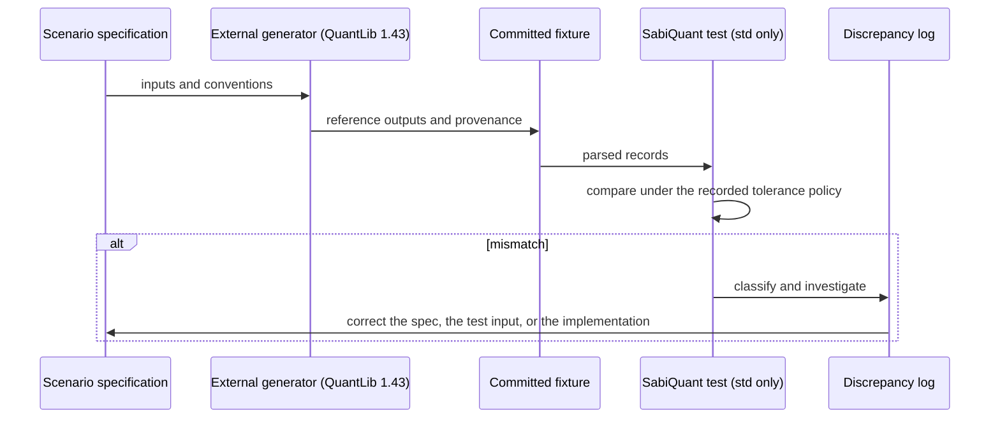

# Testing Strategy

| Field | Value |
|---|---|
| Milestone | M0 strategy; in force from M1 |
| Document status | **Accepted** with [ADR-0008](adr/ADR-0008-validation-strategy.md) on 2026-10-10, including the fixture encoding (OQ-13) |
| Related | [REQUIREMENTS](REQUIREMENTS.md), [NUMERICAL_CORRECTNESS](NUMERICAL_CORRECTNESS.md), [ADR-0008](adr/ADR-0008-validation-strategy.md), [ROADMAP](ROADMAP.md) |

All testing uses **only the Rust standard library and the standard Rust
toolchain** ([ADR-0002](adr/ADR-0002-standard-library-only.md)). There are no
third-party test, property-testing, or benchmarking frameworks. M0 created no
tests, fixtures, scripts, or CI configuration. M1 adds the shared test
support (§3), the first tests, and CI (§11).

---

## 1. Principles

1. **Tests trace to specifications.** Every test cites the requirement
   (`FR-…`, `INV-…`) and scenario (`TS-…`) it verifies.
2. **Several independent kinds of evidence.** Exhaustive enumeration,
   properties, literature examples, independent oracles, and QuantLib
   differential tests each catch different defects.
3. **Deterministic tests.** No test depends on time, randomness without a
   recorded seed, thread scheduling, or the network.
4. **QuantLib is not presumed correct.** Disagreements are classified, then
   resolved from independent sources (§7.5–§7.6).
5. **Tolerances are justified** by the exactness classes in
   [NUMERICAL_CORRECTNESS §7](NUMERICAL_CORRECTNESS.md#7-tolerance-policy).

## 2. Test levels and tooling

| Level | Purpose | Std-only mechanism |
|---|---|---|
| Unit | Behavior of one function or type | Built-in test harness (`cargo test`), tests inside each module |
| Integration | Cross-module behavior through the public API | Integration-test directory |
| Documentation tests | Examples in the docs stay correct | rustdoc doc tests, **from M2 on** |
| Boundary and failure | Every error variant and every edge | Unit and integration tests |
| Property-based | Invariants over many generated inputs | In-house deterministic PRNG (test-only, F-CORE-05) |
| Exhaustive | Full or windowed enumeration of discrete domains | Plain loops in tests |
| Differential | Agreement with QuantLib 1.43 | Committed fixtures read by a std-only parser (test-only, F-CORE-06) |
| Oracle | Agreement with exact or high-precision values | Committed oracle fixtures |
| Regression | Fixed defects stay fixed | Tests named after the issue |
| Numerical stability | Accuracy on hard input grids | Oracle fixtures on stress grids |
| Convergence (future) | Order of convergence of numerical methods | Measured error against step size or sample count |
| Cross-platform | Agreement at reproducibility level R3 | The same suite on each primary platform (CI from M1) |
| Benchmarks (future) | Measured performance | Custom harness built on `std::time::Instant` and `std::hint::black_box`. Rust's built-in `#[bench]` is unstable and is not used |

Coverage instrumentation, where used, comes from the toolchain itself (rustc's
built-in instrumentation together with the LLVM tools component), never from a
crate (§12).

## 3. Test organization and naming (from M1)

- Unit tests sit next to the code they test. Integration and differential
  tests sit in the integration-test directory (`tests/`). Shared test support
  is not public API.
- The shared test support lives in `tests/support/`: the PRNG and property
  runner (`prng.rs`), ULP and tolerance comparison (`float.rs`), and the
  fixture reader (`fixture.rs`). Integration tests include it with
  `mod support;`, and the library's unit tests include the same files through
  a `#[path]` module that exists only in test builds. Its self-tests are in
  `tests/test_support.rs`.
- A test's name says what it checks, and its documentation comment cites its
  `TS-` and `FR-`/`INV-` IDs.
- The traceability table in [REQUIREMENTS §12](REQUIREMENTS.md#12-traceability)
  is checked at each milestone review. Every `FR` must have at least one test.

## 4. Foundational test scenario catalogue

"Exact" means class E0/E1. "Tol" names a tolerance policy from
[NUMERICAL_CORRECTNESS §7.3](NUMERICAL_CORRECTNESS.md#73-exactness-classes).

### 4.1 Core

| ID | Scenario | Verifies | Inputs and expectations | Class |
|---|---|---|---|---|
| TS-CORE-01 | Every error variant can be triggered and inspected | FR-CORE-01/02 | At least one input per variant; the kind and context match | Exact |
| TS-CORE-02 | Identifier round-trip and ambiguity rejection | FR-CORE-05/06 | Every enumeration value round-trips through text. `30/360`, `Actual/Actual`, `ACT/ACT` and `Actual/365` give ambiguity errors | Exact |

### 4.2 Dates

| ID | Scenario | Verifies | Inputs and expectations | Class |
|---|---|---|---|---|
| TS-DATE-01 | Leap years, including century exceptions | FR-DATE-02 | 1900 and 2100 are not leap years; 2000 and 2400 are; 2023 is not; 2024 is | Exact |
| TS-DATE-02 | Month-end and year-end transitions | FR-DATE-03 | 2023-02-28 + 1D = 2023-03-01; 2024-02-28 + 1D = 2024-02-29; 2023-12-31 + 1D = 2024-01-01; 2100-02-28 + 1D = 2100-03-01 | Exact |
| TS-DATE-03 | Invalid date construction | FR-DATE-01 | Month 0 or 13; day 0 or 32; 2023-02-29; 2024-02-30; 2024-04-31 → invalid-date error with components | Exact |
| TS-DATE-04 | Range limits and arithmetic overflow | FR-DATE-01/03 | 0001-01-01 − 1D and 9999-12-31 + 1D → out-of-range error; adding the largest representable day count → error, never a panic | Exact |
| TS-DATE-05 | Month and year arithmetic with clamping | FR-DATE-04/05/06 | 2023-01-31 + 1M = 2023-02-28; 2024-01-31 + 1M = 2024-02-29; 2024-02-29 + 1Y = 2025-02-28; 2023-02-28 + 1M = 2023-03-28 (no end-of-month preservation); non-associativity and non-invertibility as in FS-DATE | Exact, DIFF |
| TS-DATE-06 | Exhaustive round-trip over the full range | INV-DATE-1…4 | All 3,652,059 dates: components round-trip; weekdays run in sequence; 1970-01-01 is a Thursday | Exact |
| TS-DATE-07 | ISO 8601 text | FR-DATE-08 | Round-trip for every date; malformed text (`2024-2-1`, `24-02-01`, `2024-02-30`, empty string, trailing characters) → parse error | Exact |

### 4.3 Periods and frequencies

| ID | Scenario | Verifies | Inputs and expectations | Class |
|---|---|---|---|---|
| TS-PER-01 | Normalization, equality, ordering | FR-PER-02 | `12M` = `1Y`; `14D` = `2W`; `0D` = `0M`; `1M` vs `30D` incomparable | Exact |
| TS-PER-02 | Period ↔ frequency | FR-PER-03 | Every row of the FS-PER table both ways; `5M` maps to no frequency; `Once` has no period | Exact, DIFF |
| TS-PER-03 | Arithmetic overflow and incompatible units | FR-PER-01 | Multiplying by the largest integer → error; `1M + 1D` → error | Exact |

### 4.4 Calendars

| ID | Scenario | Verifies | Inputs and expectations | Class |
|---|---|---|---|---|
| TS-CAL-01 | Null and weekends-only invariants | INV-CAL-2 | Exhaustive over 1999–2002 and 2099–2101 | Exact |
| TS-CAL-02 | Holiday overlaps | FR-CAL-01/02 | Holidays on weekends are not counted twice. In a joint calendar whose members share holidays, each holiday is counted once. Runs of consecutive holidays. With TARGET, 2021-12-25 (Sat) and 2021-12-26 (Sun) give no substitute day, so 2021-12-27 (Mon) is a business day | Exact |
| TS-CAL-03 | Joint-calendar rules | INV-CAL-3 | Exhaustive comparison of the *join holidays* and *join business days* results with the definition | Exact |
| TS-CAL-04 | Advancement | FR-CAL-05/06 | `n = 0`; ±n business days from business and non-business starts; weeks; months with end-of-month off and on; Unadjusted with end-of-month | Exact, DIFF |
| TS-CAL-05 | Business-day counting | FR-CAL-07, INV-CAL-6 | All four inclusion combinations; reversed arguments; equal dates | Exact, DIFF |
| TS-CAL-06 | TARGET against the primary source | FR-CAL-09 | Holiday lists over verified coverage match ECB publications; Easter matches the computus (2024-03-31, 2025-04-20, 2026-04-05) | Exact, SRC |
| TS-CAL-07 | Bounded search failures | FS-CAL failure cases | A custom calendar with no business days in a window → error; adjusting at 9999-12-31 → error | Exact |

### 4.5 Business-day conventions

| ID | Scenario | Verifies | Inputs and expectations | Class |
|---|---|---|---|---|
| TS-BDC-01 | Business days are unchanged by every convention | INV-BDC-1 | Exhaustive over windows | Exact |
| TS-BDC-02 | Modified Following at month boundaries | FR-BDC-01 | Weekends-only 2024-08-31 → 2024-08-30; TARGET 2024-03-29 → 2024-03-28 (Following gives 2024-04-02) | Exact, DIFF |
| TS-BDC-03 | Half-Month Modified Following around the 15th | FR-BDC-01 | Weekends-only 2024-06-15 → 2024-06-14 (Following gives 2024-06-17) | Exact, DIFF |
| TS-BDC-04 | Nearest, including ties | FR-BDC-01 | Weekends-only plus holiday 2024-07-03: tie → 2024-07-04; 2024-08-31 → 2024-08-30 | Exact, DIFF |
| TS-BDC-05 | Exhaustive differential | FR-BDC-01 | Every date in windows × seven conventions × {null, weekends-only, TARGET} against QuantLib 1.43 | Exact, DIFF |

### 4.6 Day-count conventions

| ID | Scenario | Verifies | Inputs and expectations | Class |
|---|---|---|---|---|
| TS-DCC-01 | Same and reversed dates | FS-DCC general | `YF(S, S) = 0` for every H1 convention; reversed dates per OQ-14 | Exact |
| TS-DCC-02 | Periods spanning leap years | §9.4, §9.6 | The Actual/Actual (ISDA) and AFB examples in REQUIREMENTS; 1999-07-01 → 2000-07-01 ISDA = 1.0013773486…; AFB edge 2024-02-28 → 2025-02-28 | E2, LIT |
| TS-DCC-03 | Reference-period sensitivity (ICMA) | §9.5 | Regular, short-first, long-first, short-final, and long-final examples; missing or inconsistent determination period → error | E2, LIT, DIFF |
| TS-DCC-04 | 30/360 variants diverge | §9.7 | The divergence table in REQUIREMENTS §9.7, for each variant | Exact |
| TS-DCC-05 | 30E/360 (ISDA) termination-date sensitivity | §9.7 | 2023-01-31 → 2023-02-28 gives 30 days, or 28 when the end date is the termination date | Exact |
| TS-DCC-06 | Business/252 with custom calendars | §9.8 | Weekends-only, 2024-01-01 → 2024-01-08 = 5/252; calendars with dense holidays | E1 |
| TS-DCC-07 | Exhaustive pairs against the exact rational oracle | §9 | All pairs within 1999–2002 and 2099–2101, for each convention | E1/E2, ORC |
| TS-DCC-08 | Differential for each convention | §9 | QuantLib 1.43 fixtures, within QuantLib's date range | E1/E2, DIFF |

### 4.7 Interest rates and discounting

| ID | Scenario | Verifies | Inputs and expectations | Class |
|---|---|---|---|---|
| TS-RATE-01 | Zero time | INV-R-1 | `C(0) = 1` exactly, for every compounding and for rates across the domain | Exact |
| TS-RATE-02 | Zero rate | INV-R-2 | `C(t) = 1` exactly, for `t` from 0 to 100, every compounding | Exact |
| TS-RATE-03 | Negative rates | FR-RATE-06, INV-R-9 | `r = −0.005, −0.05, −0.5`; values approaching `−m` from above; `C < 1` | E3 |
| TS-RATE-04 | Invalid compounding domains | FR-RATE-05 | `r ≤ −m`; `1 + r t ≤ 0` for Simple; `Once` or no frequency for periodic methods; implied rate with `C ≤ 0`, or with `t = 0` and `C ≠ 1` → typed errors | Exact |
| TS-RATE-05 | Non-finite inputs | NP-01 | NaN, +∞ or −∞ as rate, time, or compound factor → errors; never NaN out | Exact |
| TS-RATE-06 | Very small time fractions | §9.3 | `t = 1/365, 1e-6, 1e-12`; round-trips within TOL-E4 | E4, ORC |
| TS-RATE-07 | Large inputs | NP-02, §9.5 | `t = 100`, `r = 1.0` and `10.0`; `r t` near 709.78 and −745.13 → finite result or typed error, never ∞ or 0 | E3, Exact |
| TS-RATE-08 | Equivalent-rate consistency | INV-R-5/6/7 | Round trips across all pairs of compoundings and horizons; horizon independence for Compounded ↔ Continuous | E3/E4, PROP |
| TS-RATE-09 | Hybrid boundary | NP-12 | `t` equal to `1/m` and its neighbouring `f64` values; continuity within TOL-E3 | E3 |
| TS-RATE-10 | Differential against `InterestRate` | FR-RATE-01…04 | QuantLib 1.43 fixtures for the compound factor, discount factor, implied rate, and equivalent rate | E3/E4, DIFF |
| TS-DISC-01 | Discounting relationships | FR-DISC-01/02, INV-D-1 | `P(S, S) = 1`; PV linear in the amount; `E < S` → error | Exact, E3 |

## 5. Property-based testing without frameworks

- **Generator.** An in-house deterministic pseudo-random generator (test-only,
  F-CORE-05): SplitMix64, from Steele, Lea and Flood, "Fast splittable
  pseudorandom number generators" (OOPSLA 2014), implemented from Vigna's
  public-domain reference implementation. It uses only wrapping 64-bit integer
  arithmetic, so the sequence is identical on every platform. Its tests check
  published known-answer vectors.
- **Seeds.** Every property test uses a fixed, recorded seed and a fixed
  number of cases. Runs are reproducible on every platform. The runner gives
  each case its own seed, derived from the run seed, and a failure report
  names it, so the failing case can be replayed alone.
- **Input distributions.** Inputs are biased towards boundaries.
  - Dates: uniform over the range, with extra weight on month ends, 28/29
    February, year ends, the range edges, and century years.
  - Rates: log-uniform magnitudes between 10⁻¹² and 10, both signs, and values
    near the domain boundary `−m`.
  - Times: log-uniform between 10⁻¹² and 100, plus exact values such as `1/m`.
- **No automatic shrinking.** A failing case reports its seed and inputs. The
  developer reduces it by hand and adds it as a regression test.
- **Invariant sources.** INV-DATE, INV-PER, INV-CAL, INV-BDC, the day-count
  property table (only where it holds), and INV-R-1 to INV-R-9.

## 6. Exhaustive and bounded enumeration

Discrete domains are small enough to test exhaustively with plain loops:

| Domain | Size | Test |
|---|---|---|
| Every supported date | 3,652,059 | Round-trip, weekday sequence, leap rules |
| Date pairs in 1999–2002 (contains leap year 2000) | about 2.1 million ordered pairs | Day counts against the rational oracle |
| Date pairs in 2099–2101 (contains non-leap century 2100) | about 1.2 million ordered pairs | Same |
| Dates × conventions × calendars in windows | about 10⁴ × 7 × 3 | Adjustment invariants and differential tests |

Pair windows must stay inside QuantLib's range (1901–2199) whenever they also
serve differential testing.

## 7. Differential testing against QuantLib

### 7.1 Workflow

1. **Specify the scenario independently** from SabiQuant's specification, not
   from QuantLib's code. Write down the inputs, conventions, and the expected
   behavior class.
2. **Evaluate with QuantLib.** The external generator (§7.2) runs the scenario
   on the pinned QuantLib 1.43.
3. **Record the reference.** Results go into a fixture (§7.3), with
   provenance.
4. **Evaluate with SabiQuant.** A std-only test reads the fixture and runs the
   equivalent SabiQuant operation.
5. **Compare** using the exactness class and tolerance policy recorded in the
   fixture.
6. **Analyze differences**, classifying each one (§7.5).
7. **Document the conclusion** in the discrepancy log (§7.7) and, where
   relevant, in the compatibility notes for the feature.



QuantLib never runs during `cargo test`. Tests use only committed data.

### 7.2 Reference generator (external tool)

- Uses the **QuantLib Python package at exactly version 1.43** from PyPI
  (wheels published 2026-07-14). If wheels stop being available, a recorded
  C++ build of the pinned commit is used instead.
- It is **not part of the crate.** It lives in `validation/generator/`, which
  is excluded from the published package ([OQ-13](IMPLEMENTATION_READINESS.md#5-decision-register),
  decided 2026-10-10).
- Recorded environment: QuantLib version and commit, Python version,
  operating system and architecture, generator revision, and generation date.
- It translates SabiQuant scenario specifications into QuantLib calls through
  QuantLib's public interface only.
- It is introduced in M2, not in M0.

### 7.3 Reference fixture specification

Conceptual fields, and where each one is stored in the encoding below.

| Field | Content | Stored as |
|---|---|---|
| Fixture identifier | Unique and stable, for example `DCC-ISDA-0001` | `id` column |
| Schema version | Version of the fixture format | `schema` header key |
| Fixture set | The scenario set the file belongs to, for example `DCC-A360` | `fixture-set` header key |
| Domain | Date, period, calendar, BDC, day count, rate, or discounting | `domain` header key |
| Scenario description | One line in plain English | `description` header key; optional `notes` column per record |
| Inputs | Typed values. Dates in ISO 8601. Reals as shortest round-trip decimal text, with optional IEEE 754 bit pattern | Columns |
| Conventions | Canonical SabiQuant identifiers, plus the QuantLib construction used | Columns |
| Expected output | Value(s), or an expected error kind | Columns; `expected_error` holds an error kind name |
| Reference implementation | `QuantLib` or `oracle:<method>` | `reference` header key |
| Reference version | QuantLib `1.43` with commit `6b57206e…`; or the oracle's tool and precision | `reference-version` header key |
| Reference source | Python package version or C++ build identifier | `reference-source` header key |
| Tolerance policy | ID from NUMERICAL_CORRECTNESS §7.3, for example `TOL-E1` | `tolerance` header key; a `tolerance` column may override it per record |
| Expected error behavior | Whether QuantLib raises, returns NaN, or returns a value. What SabiQuant must do | `reference_behavior` column (`value`, `raises` or `nan`) and `expected_error` column |
| Reproduction | Generator revision, command, and parameters | `reproduction` header key |
| Generated at | UTC timestamp | `generated-at` header key |
| Platform | Generator's operating system and architecture | `platform` header key |
| Notes / discrepancy reference | Link to a log entry, if any | Optional `notes` column or header key |

**Encoding (decided, OQ-13).** A fixture file is UTF-8 text: a header of
`key: value` lines, one empty line, then a tab-separated table whose first
line declares the columns. It can be parsed with string splitting from the
standard library alone, is easy to review in diffs, and needs no JSON parser.
Floats use the shortest round-trip decimal representation. Both Python's
`repr` and Rust's float parsing are correctly rounded, so values survive the
trip between tools bit for bit.

```text
schema: 1
fixture-set: DCC-A360
domain: day-count
description: Actual/360 year fractions over the 1999-2002 window
reference: QuantLib
reference-version: 1.43 (commit 6b57206e04598f092efee66e3b367efc84771995)
reference-source: QuantLib-Python 1.43 wheel from PyPI
tolerance: TOL-E1
reproduction: validation/generator at revision <rev>: <command and parameters>
generated-at: 2026-10-10T00:00:00Z
platform: Linux x86_64

id	start	end	year_fraction	expected_error
DCC-A360-0001	2024-01-01	2024-07-01	0.5055555555555555	
```

Rules, schema version 1. The test-only reader (F-CORE-06) enforces every rule
and reports each violation as a typed error with its line number.

1. **Text.** UTF-8 without a byte-order mark. Lines end with LF or CRLF, and
   the two are treated the same; the final line ending is optional. No line
   contains control characters other than the tab separators of the table.
2. **Layout.** Header lines, exactly one empty line, the column line, then at
   least one record line. Empty lines are not allowed anywhere else.
3. **Header lines** have the form `key: value`: the key is lowercase ASCII
   letters, digits and hyphens, starting with a letter; then a colon and one
   space; then a non-empty value with no leading or trailing whitespace. Keys
   are unique. The first line is always `schema: 1`.
4. **Required keys:** `schema`, `fixture-set`, `domain`, `description`,
   `reference`, `reference-version`, `reference-source`, `tolerance`,
   `reproduction`, `generated-at`, `platform` (NFR-12). Other keys may be
   added, for example `notes`.
5. **Columns.** Names are lowercase ASCII letters, digits and underscores,
   starting with a letter, separated by single tabs, and unique. The first
   column is `id`.
6. **Records.** Each record has exactly as many tab-separated fields as there
   are columns. A field may be empty, meaning "no value". There is no escaping,
   so fields never contain tabs or line breaks. Every `id` is non-empty and
   unique within the file.
7. **Values** are typed by the test that reads them: dates as ISO 8601
   `YYYY-MM-DD`; reals as shortest round-trip decimal text, or `nan`, `inf`,
   `-inf` for deliberately non-finite inputs; optional IEEE 754 bit patterns as
   `0x` followed by 16 hexadecimal digits; conventions as canonical
   identifiers; expected errors as stable error kind names (ADR-0007).
8. **Files** use the extension `.fixture` and live under
   `validation/fixtures/`, which is excluded from the published package.

### 7.4 Comparison rules

| QuantLib result | Expected SabiQuant behavior | Outcome |
|---|---|---|
| A value | A value within the tolerance policy | Pass |
| A value | A typed error, because of an intentional domain check (for example `r ≤ −m`) | Pass only if the fixture marks an **intentional divergence** that a specification documents |
| An exception | A typed error of the expected kind | Pass |
| NaN or infinity | A typed error | Pass, marked as an intentional divergence (NP-02, NP-07) |
| Value outside tolerance | — | Fail. Classify (§7.5) |

### 7.5 Discrepancy classification

| Class | Meaning | Typical resolution |
|---|---|---|
| D1 SabiQuant defect | SabiQuant departs from its own specification | Fix the code. Add a regression test |
| D2 Convention mismatch | The two sides implement different conventions under similar names | Correct the fixture mapping, or document the difference |
| D3 Incorrect test input | The scenario or fixture was built wrongly | Fix the scenario. Regenerate |
| D4 QuantLib version difference | Behavior changed between QuantLib versions | Record it. Re-baseline per [QUANTLIB_REFERENCE §9](QUANTLIB_REFERENCE.md#9-re-baselining-policy-proposed) |
| D5 Floating-point tolerance issue | The difference is within justified error bounds but the tolerance was mis-set | Recompute the tolerance from conditioning, with evidence. Never widen it arbitrarily |
| D6 Unsupported functionality | One side does not support the scenario | Mark the scenario out of scope for the comparison |
| D7 Ambiguous specification | The sources allow more than one reading | Open an OQ. Decide using primary sources |
| D8 Confirmed reference issue | Independent sources show that QuantLib is wrong | Keep SabiQuant correct. Document it. Optionally report it upstream |
| D9 Intentional divergence | SabiQuant deliberately behaves differently (for example stricter domains) | Document it in the specification and the fixture |

### 7.6 Resolution procedure

1. Re-derive the expected value by hand or with the independent oracle, from
   the primary source.
2. If the primary source is ambiguous, classify as D7 and raise an OQ.
3. If QuantLib disagrees with the primary source, classify as D8, document it,
   and consider reporting it to QuantLib.
4. Every resolution updates the specification, the fixture, or the code, plus
   the discrepancy log, in the same pull request.

### 7.7 Discrepancy log (from M2)

`validation/DISCREPANCIES.md` has one entry per discrepancy: ID, date, fixture
IDs, observed values, class (D1–D9), sources consulted, resolution, and the
affected requirements. Entries are never deleted. Superseded entries are
marked as such.

## 8. Independent oracle testing

- **Exact rational** values for day counts and simple compounding: ratios of
  integers, reduced exactly, then rounded once to `f64`.
- **High precision** (at least 50 significant digits) for exponentials,
  logarithms, and powers, then rounded to `f64`.
- Oracle values are computed by **external tools**, for example Python's
  `fractions` and `decimal` modules, or a dedicated arbitrary-precision
  library. They are committed as fixtures with method and precision recorded.
  Python's `datetime` covers the same proleptic Gregorian range (years
  1–9999) as SabiQuant's proposed range, which makes it a convenient date
  oracle.
- Literature examples (ISDA 1999, ICMA Appendix A5, ECB calendars) are
  transcribed with exact citations.

## 9. Regression tests

- Every defect fix adds at least one test named after the issue.
- Regression tests are never deleted. If a specification changes on purpose,
  the test changes in the same pull request, which explains why.
- Fixture files are versioned. A changed reference value needs a log entry
  (§7.7).

## 10. Numerical stability and convergence tests

- **Stability grids.** For each real-valued operation, error against the
  oracle is measured over grids that stress the analyses in
  [NUMERICAL_CORRECTNESS §9](NUMERICAL_CORRECTNESS.md#9-analyses-of-foundational-computations):
  tiny and large `t`, tiny and large `r`, `r` near `−m`, and `C` near 1.
  Maximum and percentile ULP errors are reported.
- **Convergence (future).** For iterative and discretised methods (solvers,
  quadrature, finite differences, Monte Carlo), the observed order of
  convergence is measured against the theoretical one. Examples: Monte Carlo
  standard error proportional to `N^(-1/2)`; scheme order `p` for finite
  differences. Tolerances use class E5.

## 11. Cross-platform testing

- **Platforms ([OQ-08](IMPLEMENTATION_READINESS.md#5-decision-register),
  decided 2026-10-10).** Primary: x86_64 Linux, aarch64 macOS, x86_64
  Windows. Secondary, best-effort: aarch64 Linux, x86_64 macOS.
- The same suite runs on every primary platform. There are no
  platform-specific expected values.
- Possible sources of difference: the system `libm`, toolchain versions,
  compile-time versus run-time evaluation, and file handling (line endings)
  when reading fixtures. Fixtures are read in a way that ignores line-ending
  style.
- A failure report includes the platform, toolchain version, and observed ULP
  error.
- CI (`.github/workflows/ci.yml`, from M1) runs the suite on the three
  primary platforms with the latest stable Rust, and again on the declared
  MSRV. It also checks formatting, Clippy with warnings as errors, the
  documentation build, and the dependency policy, and on pull requests the
  DCO sign-off of every commit.

## 12. Coverage: what "sufficient" means

Statement coverage is **informational only**. A percentage is not a gate,
because a high percentage can hide missing domain cases, and the cases that
matter in finance are often a single line (the 31st, 29 February, the
termination date).

For an implementation milestone, sufficient coverage means **meaningful domain
coverage**:

1. Every `FR` and `INV` in scope has at least one test.
2. Every error variant is triggered (TS-CORE-01).
3. Every convention is tested across the boundary classes: month ends, 28/29
   February, the 30th and 31st, year ends, and century years.
4. Every discrete domain is enumerated exhaustively or over documented
   windows (§6).
5. Every real-valued output has an exactness class, a tolerance policy, and
   measured error against an oracle.
6. Every QuantLib-comparable feature has differential fixtures, and every
   discrepancy is classified.
7. The suite passes on all primary platforms.

Toolchain coverage reports are reviewed to find untested branches, which then
become new scenarios.

## 13. Performance benchmarking strategy (future)

Benchmarks are written from M6 on, and only once correctness evidence exists.
No benchmark code is written in M0.

| Concern | Policy |
|---|---|
| Harness | Custom benchmark targets (std only), timing with `std::time::Instant`, `std::hint::black_box` to stop dead-code elimination |
| Build | Release profile with documented settings: optimization level, LTO, codegen units, and no target-specific CPU flags unless reported |
| Warm-up | A fixed warm-up period before measurement |
| Repetition and statistics | Many samples. Report the median and a dispersion measure (interquartile range or MAD), plus a confidence interval |
| Noise control | Record the machine, OS, CPU model, frequency-scaling state, and background load. Pin threads where possible |
| Inputs | Documented, realistic input distributions, plus worst cases (for example long holiday runs) |
| Allocation | Allocation counts measured where relevant, using a counting global allocator in the benchmark binary only |
| Throughput and latency | Report both where relevant |
| Comparison with QuantLib | Only for **equivalent workloads** (identical inputs and outputs), on the same machine, against a C++ build with recorded compiler and flags. Python-binding overhead is excluded. The method is published with the results |
| Claims | No performance claim without a published, reproducible benchmark. Claims such as "Rust is faster than C++" are never made |
| Correctness guard | Every benchmarked path is covered by correctness tests. An optimization that changes results needs the same validation as a behavior change |

## 14. Testing exit criteria by milestone

These are summarized here. The full acceptance criteria are in
[ROADMAP](ROADMAP.md).

| Milestone | Testing exit criteria |
|---|---|
| M1 | Error-variant coverage; PRNG and ULP support tested; fixture reader tested against malformed input; CI matrix green |
| M2 | TS-DATE and TS-PER complete; exhaustive date round-trip; differential fixtures for date and period behavior |
| M3 | TS-CAL, TS-BDC, TS-DCC complete; TARGET against the ECB source (if approved); exhaustive day-count oracle; differential tests |
| M4 | TS-RATE and TS-DISC complete; measured error distributions; TOL-E3 and TOL-E4 constants fixed with evidence |
| M5 | Full differential suite green or every discrepancy classified; cross-platform R3 confirmed; traceability matrix complete |
